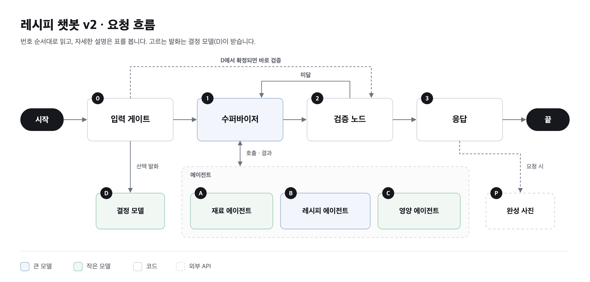

# 레시피 챗봇 v2

가진 재료와 조건(알레르기, 칼로리 등)을 말하면 레시피를 추천하는 챗봇입니다. 수퍼바이저 에이전트가 요청을 읽고 재료·레시피·영양 에이전트에 일을 나눠 맡기며, 모든 모델은 로컬에서 돌립니다.

> v1: [KTB4-emet-LLM-Application-Project](https://github.com/100-hours-a-week/KTB4-emet-LLM-Application-Project) (고정 LangGraph로 만든 재료 기반 레시피 챗봇)



## 핵심 아이디어

- **판단은 모델, 확인은 코드**: 수퍼바이저가 다음에 할 일을 고르고, 검증 노드(코드)가 알레르기·영양 조건을 확인합니다. 조건을 어기면 다시 만듭니다.
- **큰 모델 1개 + 작은 모델 1개**: 깊은 추론(수퍼바이저, 레시피)은 큰 모델, 반복 작업(재료, 영양, 후보 선택)은 작은 모델이 맡고, 역할 차이는 어댑터로 만듭니다.
- **고르는 말은 큰 모델 없이**: "2번", "계란말이로 할게" 같은 선택은 입력 게이트(코드)와 결정 모델이 처리합니다.

## 노드

| 번호 | 노드 | 하는 일 | 실행 주체 |
|---|---|---|---|
| 0 | 입력 게이트 | 선택 발화면 결정 모델로, 아니면 수퍼바이저로 보냄 | 코드 |
| 1 | 수퍼바이저 | 의도 파악, 에이전트 배정, 결과 종합 | 큰 모델 |
| A | 재료 에이전트 | 재료 추출·정규화, 궁합 검사 | 작은 모델 |
| B | 레시피 에이전트 | 레시피 검색·생성·변형, 후보 목록 | 큰 모델 |
| C | 영양 에이전트 | 영양 계산, 대체 재료 추천 | 작은 모델 + 코드 |
| D | 결정 모델 | 후보 중 고른 것 확정 (규칙 → 작은 모델 → 되묻기) | 코드 + 작은 모델 |
| 2 | 검증 노드 | 알레르기·영양·궁합 조건 확인 | 코드 |
| 3 | 응답 | 레시피 또는 후보 목록을 스트리밍으로 전송 | 코드 |
| P | 완성 사진 (선택) | 완성 모습 이미지 생성 | 외부 API |

입력·출력·다음 노드까지 담은 전체 표는 [architecture-v2.nodes.md](docs/diagrams/architecture-v2.nodes.md)에 있습니다.

## v1과 비교

| | v1 | v2 |
|---|---|---|
| 흐름 | 분류기 하나가 경로를 고정 | 수퍼바이저가 상황에 따라 선택 |
| 모델 | 외부 API (Claude → Gemini) | 로컬: 큰 모델 + 작은 모델 + 어댑터 |
| 후보 선택 | 분류 프롬프트 | 입력 게이트 + 결정 모델 |
| 조건 확인 | 없음 | 검증 노드, 미달이면 재시도 |
| 영양 정보 | 없음 | 식품영양성분 DB로 계산 |
| 레시피 변형 | 기획만 | 구현 예정 |
| 완성 사진 | 없음 | 외부 이미지 모델 (검토 중) |

## 상태

기반 코드 단계입니다. 그래프와 에이전트는 가짜 모델로 테스트했고, 실제 모델은 벤치마크로 고른 뒤 연결합니다. 진행 상황은 [업무 플로우](docs/workflow.md)에 있습니다.

## 빠른 시작

```bash
uv sync                 # Python 3.14 + 의존성 설치
uv run pytest -q        # 테스트
uv run ruff check .     # 린트
```

테스트는 다음 두 종류만 레포에 둡니다. 실제 사이트나 실제 모델을 부르는 확인과 일회성 점검 스크립트는 레포 밖에서 돌립니다.

| 종류 | 언제 추가하나 |
|---|---|
| 계약 테스트 | 동작이 정해졌을 때, 또는 깨지면 피해가 큰 규칙일 때 (재시도 한도, 요청 간격, 학습·RAG 분리 등) |
| 회귀 사례 | 버그나 새 예외를 고칠 때 대표 사례 1~2개 |

| 경로 | 내용 |
|---|---|
| `src/recipe_chatbot/graph.py` | 그래프 조립 |
| `src/recipe_chatbot/nodes.py` | 모든 노드 |
| `src/recipe_chatbot/selection.py` | 입력 게이트와 결정 모델 규칙 |
| `src/recipe_chatbot/models.py` | 모델 라우터, vLLM·Ollama 클라이언트, 가짜 모델 |
| `src/recipe_chatbot/tools.py` | 재료·궁합·검색·영양 계산 도구 |
| `src/recipe_chatbot/domain/` | v1에서 옮긴 재료명 정규화와 궁합 검사 |
| `src/recipe_chatbot/ingest/` | 레시피 수집 (출처 어댑터, 상태표, 파싱, 정제) |
| `config/models.example.toml` | 에이전트별 모델 설정 예시 |

## 문서

| 문서 | 내용 |
|---|---|
| [설계 기록](docs/architecture/recipe-chatbot-v2-architecture.md) | 왜 이런 구조인지: 검토한 초안, 결정과 근거 |
| [작업 계획](docs/roadmap.md) | 단계와 순서, 병행 구간 |
| [업무 플로우](docs/workflow.md) | 업무별 상태와 날짜, 결과 |
| [스크럼](docs/scrum/README.md) | 데일리·주간 스크럼과 보드 3개(업무, 데일리, 주간), 마일스톤 |
| [평가 데이터셋](data/eval/README.md) | 벤치마크용 역할별 평가 데이터 |
| [레시피 수집](docs/data-ingest.md) | RAG·학습용 레시피 수집 단계와 출처별 이용 범위 |

<details>
<summary>그림 관리 방법</summary>

- 확정 그림은 `docs/images/*.png`이고, 원본은 `docs/diagrams/*.spec.json` 명세입니다. 검토 중인 초안만 Mermaid나 화이트보드로 그립니다.
- 그림에는 번호와 노드명만 넣고, 설명은 표나 본문에 씁니다.
- 그림 오른쪽 아래의 `버전 · 작성 일시`는 명세 내용이 바뀔 때만 바뀝니다. 문서와 그림의 버전·일시를 비교하면 그림이 최신인지 알 수 있습니다.
- 그림은 작성자 로컬의 `spec-figure` 스킬로 만듭니다.

```bash
for f in docs/diagrams/*.spec.json; do python3 ~/.claude/skills/spec-figure/scripts/figure.py "$f" --out docs/images; done
```

`architecture-v2` 명세를 고치면 `docs/diagrams/architecture-v2.nodes.md`도 다시 생성됩니다.

</details>
