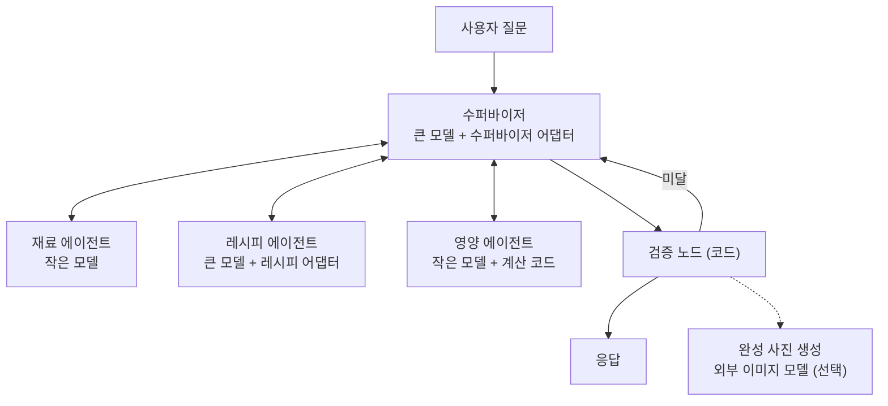

# 레시피 챗봇 v2

보유한 재료와 조건으로 요리 레시피를 추천하는 동적 멀티 에이전트 챗봇입니다.

> v1: [KTB4-emet-LLM-Application-Project](https://github.com/100-hours-a-week/KTB4-emet-LLM-Application-Project). 고정 LangGraph로 만든 재료 기반 레시피 챗봇

## 상태

설계 단계입니다. 아직 코드는 없습니다.

## v1에서 달라지는 점

| | v1 | v2 |
|---|---|---|
| 흐름 제어 | 분류기 하나가 경로를 정하는 고정 그래프 | 수퍼바이저가 에이전트에 일을 맡기는 동적 구조 |
| 모델 | 외부 API (Claude → Gemini) | 로컬 모델 중심: 큰 모델 1개 + 작은 모델 1개 + 역할별 어댑터 |
| 영양 정보 | 미사용 | 식품영양성분 DB로 코드가 계산 |
| 재시도 | 없음 | 검증 노드를 통과하지 못하면 다시 시도 |
| 레시피 변형(아렌지) | 기획만 함 | 구현 예정 |
| 완성 사진 | 없음 | 외부 이미지 모델로 생성 (검토 중) |

## 구조 (초안)

## 문서

- [v2 아키텍처 설계 기록](docs/architecture/recipe-chatbot-v2-architecture.md): v1 분석, 검토한 초안 A~D, 결정과 이유, 모델 전략, 진행 순서
