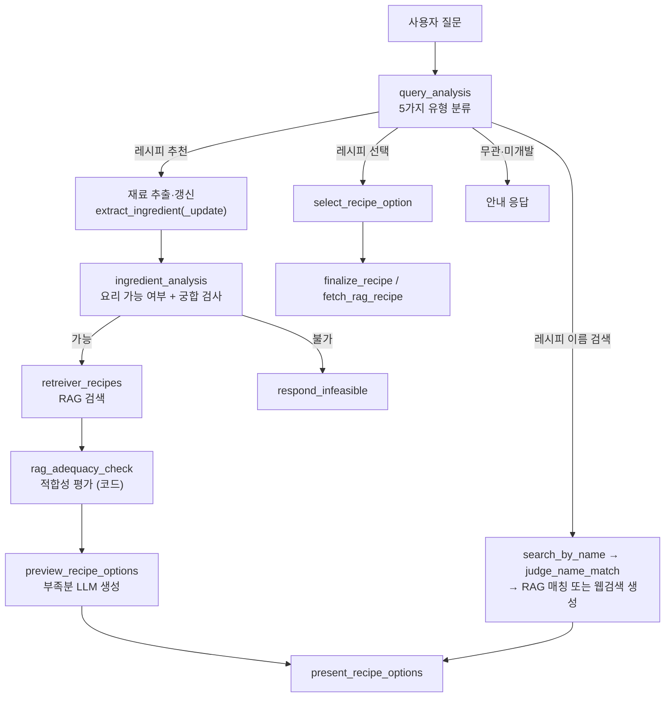
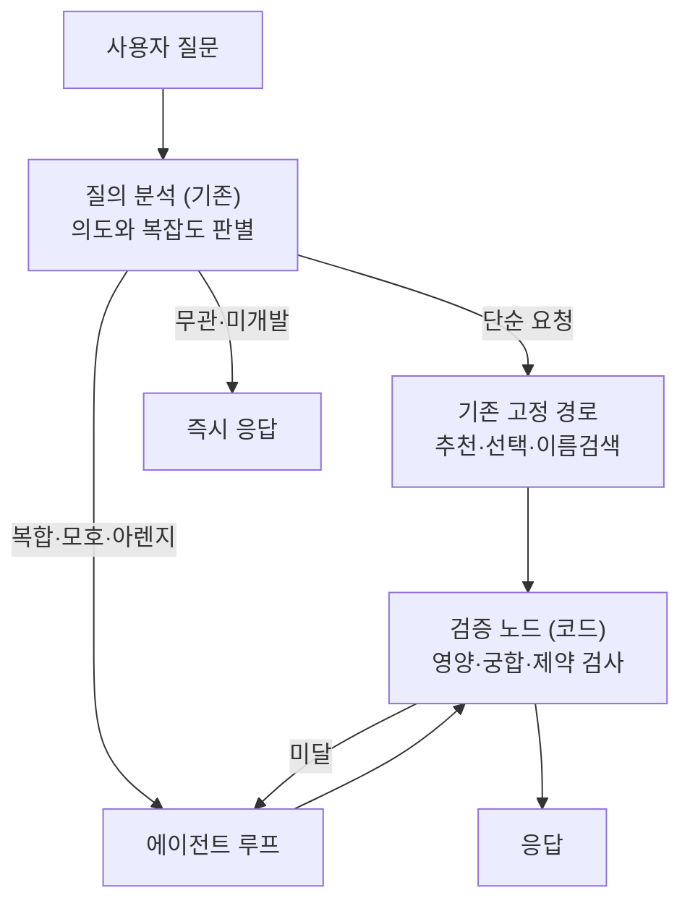
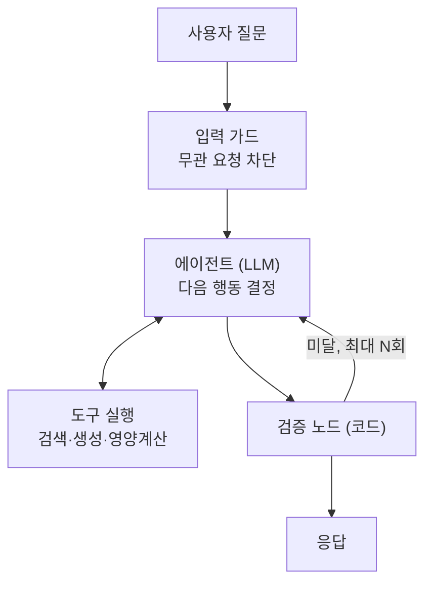
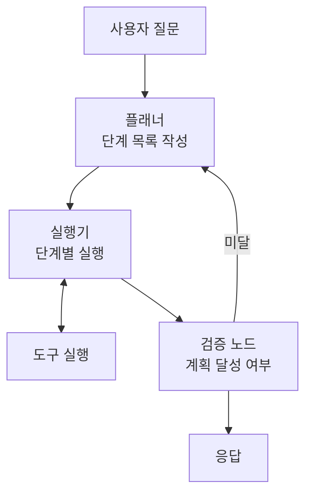
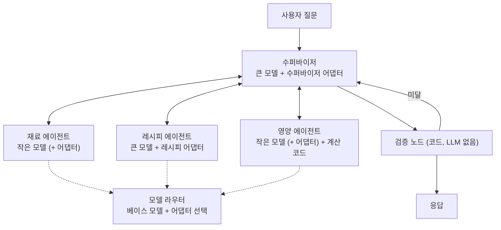
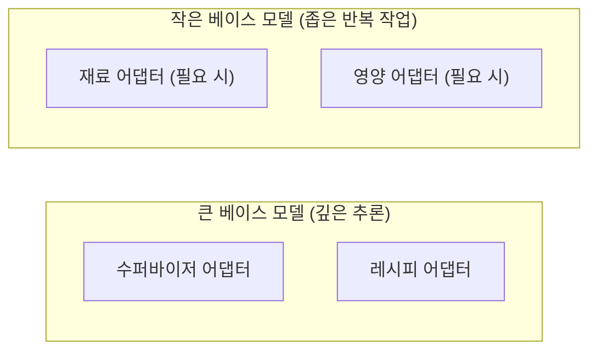
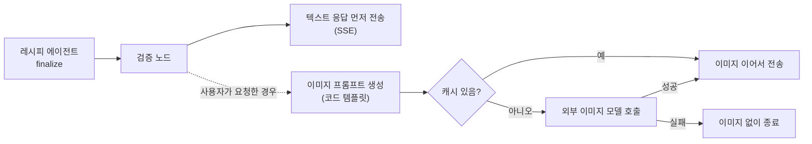

# 레시피 챗봇 v2 아키텍처 설계 기록

> 작성일: 2026-11-24
> 대상: `KTB4-emet-LLM-Application-Project` (레시피 챗봇 v1) → 레시피 챗봇 v2
> 목적: v1의 고정 LangGraph 구조가 v2에서 어떤 형태로, 왜 바뀌었는지 흔적을 남긴다.

---

## 1. v2의 목표

| 목표 | 설명 |
|---|---|
| 동적 에이전트 | 요청 유형을 미리 고정하지 않고, 에이전트가 필요한 도구와 순서를 스스로 고른다 |
| 로컬 모델 중심 하이브리드 | 모든 에이전트를 로컬 모델로 운영한다. 깊은 추론은 큰 모델, 좁은 반복 작업은 작은 모델이 맡고, 역할별 차이는 어댑터로 만든다 |
| 영양소 데이터 연동 | 식약처 식품영양성분 DB로 레시피의 영양 성분과 칼로리를 코드로 계산한다 |
| 레시피 변형(아렌지) | v1에서 기획만 하고 보류한 기능을 구현한다 |
| 완성 사진 생성 (검토 중) | 확정된 레시피의 완성 모습을 이미지로 보여준다. 지금 단계에서는 외부 이미지 모델을 쓴다 (4.6) |

---

## 2. 출발점: v1 구조 요약

### 2.1 그래프 구조

- `graph.py`의 `StateGraph`에 노드 20여 개가 고정된 경로로 연결되어 있다.
- 첫 노드 `query_analysis`가 질문을 5가지 유형(`레시피 추천`, `레시피 선택`, `레시피 이름 검색`, `NONETYPE`, `NONE`)으로 분류하고 경로를 정한다.
- 한 턴에 한 경로만 지나가고 끝나며, 되돌아가는 루프가 없다. `states.py`의 `total_loop` 필드는 선언만 되어 있고 쓰이지 않는다.

### 2.2 v1에서 그대로 살릴 자산

LLM 없이 순수 코드로 동작하는 부분이라 v2에서도 도구나 검증 로직으로 재사용한다.

| 자산 | 파일 | v2에서의 쓰임 |
|---|---|---|
| 재료명 동의어 정규화 | `ingredient_synonyms.py` | 재료 정규화, 영양 DB 매칭 키 |
| 재료 궁합 검사 | `food_combination_matcher.py`, `food_combination_taboo.json` | 궁합 검사 도구, 검증 노드 |
| RAG 적합성 평가 | `nodes/preview_recipes.py` (`evaluate_rag_options`) | 레시피 검색 도구 내부 |
| 구조화 출력 + 공급자 폴백 | `llm.py` (`invoke_structured`) | 모델 라우터로 확장 |
| 정형 레시피 스키마 | `schems.py` (`StructuredRecipe` 등) | 에이전트 간 데이터 계약 |
| SSE 스트리밍 | `main.py` | 그대로 유지 |
| 테스트 케이스 | `docs/기능테스트`, `docs/실제로직테스트` | v1 대비 퇴행 검사 세트 |

### 2.3 v1의 한계 (v2로 가는 이유)

1. **분류기 하나가 입구를 지킨다.** 여러 의도가 섞인 요청("땅콩 빼고 단백질 높게, 아까 그거 좀 맵게")을 하나의 유형으로만 처리할 수 있다.
2. **아렌지 기능이 막혔다.** "대파 빼줘"가 재료 목록 변경인지 완성 레시피 수정인지 분류기로는 구분할 수 없다. (`docs/추후추가기능/20260807_2059_레시피_변형(아렌지)_기능_기획.md`)
3. **결과를 검토하고 다시 만드는 루프가 없다.** 생성 결과가 조건에 맞지 않아도 그대로 응답한다.
4. **영양 DB가 연결되지 않았다.** README에 "DB(미사용)"으로 남아 있다.

### 2.4 v1의 모델 사용 이력

| 시기 | 구성 | 바꾼 이유 |
|---|---|---|
| 초기 | Ollama 로컬 모델 | — |
| 배포 시 | Claude API로 전환 | EC2에 GPU 인스턴스를 띄우는 비용 부담 |
| 이후 | vLLM 제거, Gemini 폴백 추가 | 운영 단순화 |
| 베타테스트 | Gemini만 사용 (temperature 0.3) | API 한도와 품질 튜닝 |

`self_model/` 폴더와 `llm.py`의 `"self"` provider 자리는 로컬 모델 연동을 위해 남겨둔 흔적이다. v2는 여기서 다시 출발한다.

---

## 3. 검토한 초안

색 구분: 클라우드 LLM이 판단하는 동적 부분 / 로컬 LLM이 맡는 부분 / 코드로 결정되는 고정 부분.

### 초안 A. 하이브리드 라우터

- **구조**: v1 분류기를 유지하고 `QueryType`에 "복합 요청" 유형을 추가한다. 그 경로에만 에이전트 루프를 붙인다.
- **장점**: 작업량이 가장 작고, 기존 테스트로 퇴행을 바로 확인할 수 있다.
- **단점**: 분류기가 입구를 계속 지키므로 아렌지 모호성 문제가 완전히 사라지지 않는다.

### 초안 B. 단일 에이전트 + 검증 노드

- **구조**: 분류기를 없애고 에이전트 하나가 도구 8개 정도를 골라 쓴다.
- **장점**: 복합 요청을 자연스럽게 처리하고, 모호하면 에이전트가 직접 되묻는다.
- **단점**: 노드를 도구로 다시 묶는 작업량이 크다. 에이전트 하나가 모든 판단을 맡아서 품질이 그 모델의 도구 호출 능력에 크게 좌우된다. 모델이 하나라 로컬/클라우드 분담이 어렵다.

### 초안 C. 계획 후 실행 (Plan-and-Execute)

- **구조**: 플래너가 단계 계획을 세우고, 실행기가 단계별로 도구를 호출한다.
- **장점**: 실행 과정이 투명하고 진행 단계를 사용자에게 보여주기 좋다. 실패 지점을 디버깅하기 쉽다.
- **단점**: 단순 요청에도 플래너 호출이 추가되어 느리다. 짧게 주고받는 대화형 챗봇에는 무겁다.

### 초안 D. 수퍼바이저 멀티 에이전트 (채택)

- **구조**: 수퍼바이저가 의도를 파악해 담당 에이전트에 일을 맡기고 결과를 종합한다. 각 에이전트는 자기 도구만 가진다.
- **장점**: 에이전트마다 다른 모델을 붙일 수 있어 로컬/클라우드 분담이 구조에 자연스럽게 녹는다. 에이전트별 프롬프트와 도구가 작아서 작은 로컬 모델도 감당할 수 있다. 담당 영역별로 따로 테스트하고 교체할 수 있다.
- **단점**: 에이전트 사이를 오가는 호출이 늘어 지연과 비용이 커진다. 상태를 어느 에이전트가 쓰고 읽는지 계약을 명확히 해야 한다.

### 비교

| | A 하이브리드 | B 단일 에이전트 | C 계획 후 실행 | D 수퍼바이저 |
|---|---|---|---|---|
| 기존 코드 재사용 | 거의 전부 | 함수 단위 | 함수 단위 | 함수 단위 |
| 작업량 | 작음 | 큼 | 큼 | 가장 큼 |
| 복합 요청 처리 | 에이전트 경로만 | 강함 | 강함 | 강함 |
| 아렌지 모호성 해결 | 일부 | 해결 | 해결 | 해결 |
| 로컬/클라우드 분담 | 노드 단위로 가능 | 어려움 (모델 1개) | 플래너/실행기 2단 | 에이전트 단위로 자연스러움 |
| 응답 속도와 비용 | 단순 요청은 v1과 같음 | 늘어남 | 많이 늘어남 | 늘어남 (로컬로 일부 상쇄) |
| 모델 의존도 | 낮음 | 높음 | 중간 | 에이전트별로 분산 |

---

## 4. 결정: 초안 D

### 4.1 D를 고른 이유

v2의 핵심 목표가 **로컬 모델과 클라우드 모델의 하이브리드 운영**이기 때문이다.

- 하이브리드 라우팅 자체는 A~C에서도 노드 단위로 할 수 있다. 하지만 D는 "어떤 일을 어떤 모델이 맡는가"가 곧 에이전트의 경계여서, 모델 배치가 구조에 드러난다.
- 재료 정규화, 영양 계산처럼 범위가 좁고 반복적인 일은 작은 모델로 충분하다. 의도 파악과 레시피 생성처럼 깊은 추론이 필요한 일만 큰 모델에 맡기면, 모델 크기를 역할에 맞게 나눌 수 있다. (최종 결정은 4.3 참고: 모두 로컬, 큰 모델 1개 + 작은 모델 1개 + 어댑터)
- 에이전트마다 프롬프트와 도구가 작아서, 성능이 낮은 로컬 모델에서도 구조화 출력 실패가 줄어든다.

### 4.2 구성 요소

| 구성 요소 | 역할 | 모델 | 도구 | v1 출처 |
|---|---|---|---|---|
| 수퍼바이저 | 의도 파악, 담당 배정, 결과 종합, 모호하면 되묻기 | 큰 모델 + 수퍼바이저 어댑터 | 에이전트 호출 | `query_analysis`, 분기 함수들 |
| 재료 에이전트 | 재료 추출·추가·삭제·교체, 정규화, 궁합 검사, 요리 가능 여부 | 작은 모델 (+ 필요 시 어댑터) | `update_pantry`, `normalize`, `check_combination` | `nodes/ingredients.py`, `ingredient_analysis`, `ingredient_synonyms.py`, `food_combination_matcher.py` |
| 레시피 에이전트 | RAG 검색, 이름 검색, 후보 생성, 최종 레시피, 아렌지 | 큰 모델 + 레시피 어댑터 | `search_recipes`, `search_dish_by_name`, `generate_recipe`, `finalize_recipe`, `modify_recipe` | `nodes/recipes.py`, `nodes/preview_recipes.py`, `nodes/name_search.py`, `rag/` |
| 영양 에이전트 | 영양 계산, 대체 재료 추천, 목표 대비 차이 설명 | 작은 모델 (+ 필요 시 어댑터) + 계산 코드 | `calc_nutrition`, `find_substitute` | 신규 (식약처 DB) |
| 검증 노드 | 영양 목표, 궁합 경고, 알레르기·제약 검사. 미달이면 수퍼바이저로 되돌림 | 없음 (순수 코드) | — | `build_combination_warnings` + 신규 |
| 모델 라우터 | 에이전트별 베이스 모델과 어댑터 선택, 실패 처리, 호출 기록 | — | — | `llm.py` 확장 |

### 4.3 모델 전략 (2026-11-24 결정)

**모든 에이전트를 기본적으로 로컬 모델로 운영한다.** 베이스 모델은 큰 모델 1개, 작은 모델 1개만 두고, 역할별 차이는 LoRA 같은 어댑터로 만든다.

| 베이스 | 맡는 에이전트 | 이유 | 진행 방식 |
|---|---|---|---|
| 큰 모델 1개 | 수퍼바이저, 레시피 | 의도 파악, 여러 단계 판단, 레시피 생성처럼 깊은 추론이 필요 | 파인튜닝으로 역할별 어댑터 제작 |
| 작은 모델 1개 | 재료, 영양 | 추출·정규화·계산 설명처럼 범위가 좁고 반복적 | v1 Ollama 결과와 작은 모델 후보들을 벤치마크해서 선택. 프롬프트만으로 부족한 경우에만 어댑터 추가 |

**이 구조의 장점**
- 같은 베이스를 쓰는 에이전트끼리 GPU 메모리를 공유한다. 큰 모델을 두 번 띄우지 않아도 수퍼바이저와 레시피 에이전트를 함께 운영할 수 있다.
- 어댑터는 크기가 작아서 역할을 추가하거나 다시 학습할 때 베이스 모델 전체를 바꿀 필요가 없다.
- 클라우드 API 비용이 없고, 사용자 데이터가 외부로 나가지 않는다.

**모델 라우터 정책 (초안)**
1. 에이전트마다 `(베이스 모델, 어댑터)` 조합을 설정 파일로 지정한다. 예: `supervisor: (big, supervisor-lora)`, `ingredient: (small, null)`
2. `llm.py`의 `get_llm(provider, model)`에 `"local"` provider를 추가하고, 요청마다 어댑터 이름을 지정할 수 있게 한다.
3. 구조화 출력 검증(Pydantic)에 실패하면 같은 모델로 한 번 재시도하고, 그래도 실패하면 안전한 기본 응답으로 처리한다. 클라우드 폴백을 남길지는 미정이다 (8장).
4. 실패 횟수와 사유를 기록해서 어댑터 재학습이 필요한 에이전트를 찾는 근거로 쓴다.

**서빙 방식 고려**
- 하나의 베이스 모델에 여러 어댑터를 요청마다 바꿔 끼우려면 multi-LoRA 서빙을 지원하는 서버(예: vLLM)가 적합하다.
- Ollama는 Modelfile의 `ADAPTER`로 어댑터별 모델을 만드는 방식이라, 작은 모델 벤치마크와 개발 단계에 쓰기 좋다.
- **결정 (2026-11-24)**: vLLM을 먼저 시도하고, 로컬 환경에서 안 되면 Ollama를 쓴다.

**파인튜닝 데이터 출처 (후보)**
- v1 대화 로그 (일별 로테이션, S3 아카이브)
- v1 LangSmith 트레이스 (`evaluate/export_langsmith_traces.py`)
- v1 기능 테스트·E2E 테스트 케이스 (학습용이 아니라 평가용으로 분리해서 보관)
- 수퍼바이저 어댑터는 도구 호출 형식을 학습해야 하므로, 에이전트 호출 순서가 담긴 트레이스 데이터가 따로 필요하다.

### 4.4 상태 설계 원칙

- v1의 `OverrallState` 필드(재료 목록, 보여준 레시피 id와 제목, 완성 레시피 캐시)는 유지한다.
- 에이전트는 자기 담당 필드만 쓴다. 예를 들어 `ingredient_list`는 재료 에이전트만, `structured_recipe`는 레시피 에이전트만 쓴다.
- 도구는 LangGraph `Command`로 state를 업데이트해서, v1의 중복 방지 로직(`shown_rag_ids`, `shown_titles`)을 그대로 이어 쓴다.
- 루프 횟수는 v1에서 미사용이던 `total_loop`을 살려서 상한(N회)을 건다.

### 4.5 검증 노드 원칙

검증 노드는 LLM을 쓰지 않는다. v1에서 동의어 사전과 궁합 검사를 순수 코드로 만든 것과 같은 이유다. 비용이 들지 않고, 결과가 항상 같으며, 에이전트가 결과를 마음대로 통과시키지 못하게 막는다.

### 4.6 완성 사진 생성 (외부 모델, 로컬 원칙의 예외)

> 상태: 검토 중 (2026-11-24 추가)

레시피 에이전트가 확정한 레시피의 완성 모습을 이미지로 생성해 사용자에게 함께 보여준다.

#### 구조상 위치: 에이전트가 아닌 비동기 후처리 단계

이미지 생성은 판단이 필요한 일이 아니라 "확정된 레시피 → 이미지" 변환이다. 그래서 수퍼바이저가 호출하는 에이전트로 두지 않고, 검증을 통과한 뒤 실행되는 고정 단계로 둔다.

- 프롬프트는 `StructuredRecipe`의 요리 이름, 주재료, 조리 방식으로 만든다. 한국 음식은 이름보다 생김새를 묘사하는 것이 정확하다. (예: "볶은 밥, 붉은 양념, 위에 반숙 계란, 검은 그릇")
- 이미지는 수 초에서 수십 초가 걸리므로 레시피 텍스트를 먼저 보내고 이미지는 나중에 붙인다. v1의 SSE 스트리밍을 활용한다.
- 기본은 꺼둔다. 사용자가 "완성 사진 보기"를 눌렀을 때만 생성한다.

#### 외부 모델을 쓰는 이유 (로컬 원칙의 예외)

| 이유 | 설명 |
|---|---|
| GPU 메모리 경쟁 회피 | 큰 LLM과 이미지 모델이 한 GPU를 나눠 쓰지 않아도 된다. 로컬 GPU는 에이전트에만 쓴다 |
| 핵심 작업 집중 | v2의 핵심은 큰 모델 파인튜닝, 작은 모델 벤치마크, 영양 DB 연동이다. 이미지 모델 학습까지 하면 범위가 너무 넓어진다 |
| 교체가 쉬운 위치 | 에이전트 루프 밖의 후처리 단계라서 나중에 로컬로 바꿔도 다른 부분에 영향이 없다 |
| 빠른 가치 검증 | 학습 없이 바로 결과를 보고, 이 기능이 사용자에게 의미 있는지 먼저 확인한다 |

#### 설계 원칙

- **공통 인터페이스**: `ImageGenerator.generate(recipe) -> image_url` 같은 인터페이스를 정하고 제공사별 구현을 분리한다. v1 `llm.py`의 provider 구조와 같은 방식이다. 로컬로 옮길 때는 구현 하나만 추가한다.
- **캐싱**: `recipe_id` 또는 제목과 재료로 만든 해시로 생성 이미지를 저장하고 재사용한다.
- **실패 허용**: 이미지 생성이 실패해도 레시피 응답은 정상으로 끝난다.
- **AI 생성 표시**: 이미지에 "AI가 생성한 예시 이미지이며 실제와 다를 수 있음"을 표시한다. 실제 완성 사진으로 오해하지 않게 한다.
- **RAG 출처 레시피**: 원본 사이트에 실제 사진이 있으므로, 이미지를 생성하는 대신 출처 링크로 연결하는 선택지도 둔다. 원본 사진을 복사해서 보여주지 않는다.
- **외부 전송 데이터 최소화**: 프롬프트에는 레시피 정보만 넣고, 사용자 원문 발화나 개인 정보는 넣지 않는다.

#### 제공사 선정 방법

- 한국 음식 10~20개(예: 김치볶음밥, 된장찌개, 잡채)로 후보 제공사 몇 곳을 비교한다.
- 비교 기준: 생김새 정확도, 이미지당 비용, 생성 시간, 생성물 이용 약관(상업적 이용 조건).
- v1에서 Gemini API를 쓰고 있으므로 같은 계정에서 쓸 수 있는 이미지 모델이 있는지도 확인한다.

#### 로컬로 옮길 조건 (v3 후보)

아래 중 하나가 충족되면 로컬 이미지 모델로 옮기는 것을 다시 검토한다.
- GPU 여유가 생겨 LLM과 이미지 모델을 분리해서 돌릴 수 있을 때
- 월 이미지 생성 비용이 정해둔 기준을 넘을 때
- 학습 이용이 허용된 한국 음식 이미지 데이터(예: AI Hub 한국 음식 이미지)로 LoRA 어댑터를 학습할 준비가 됐을 때. 만개의 레시피 사진은 사용자 저작물이라 학습에 쓰지 않는다.

---

## 5. v1 → v2 노드 매핑

| v1 노드 | v2 위치 |
|---|---|
| `query_analysis`, `conditional_query_type` | 수퍼바이저 |
| `respond_undevopled`, `respond_unrealated`, `undeveloped` | 수퍼바이저의 직접 응답 |
| `reset_recipe_options`, `extract_ingredient`, `extract_ingredient_update`, `apply_ingredient_modification` | 재료 에이전트 `update_pantry` |
| `ingredient_analysis`, `respond_infeasible` | 재료 에이전트 (요리 가능 여부 판정) |
| `retreiver_recipes`, `rag_adequacy_check` | 레시피 에이전트 `search_recipes` |
| `preview_recipe_options`, `present_recipe_options` | 레시피 에이전트 `generate_recipe` + 수퍼바이저 응답 종합 |
| `select_recipe_option`, `finalize_recipe`, `fetch_rag_recipe` | 레시피 에이전트 `finalize_recipe` |
| `search_by_name`, `filter_valid_candidates`, `judge_name_match`, `resolve_rag_name_match`, `generate_recipe_by_name` | 레시피 에이전트 `search_dish_by_name` |
| (없음) | 레시피 에이전트 `modify_recipe` (아렌지) |
| (없음) | 영양 에이전트 `calc_nutrition`, `find_substitute` |
| (없음) | 검증 노드 |
| (없음) | 완성 사진 생성 후처리 단계 (외부 이미지 모델) |

---

## 6. 리스크와 대응

| 리스크 | 대응 |
|---|---|
| 로컬 모델의 구조화 출력 실패 | 에이전트별 스키마를 작게 유지하고, 재시도 후 안전한 기본 응답. 실패 기록을 재학습 근거로 사용 |
| 로컬 모델의 한국어 품질 | 한국어 성능이 검증된 모델 후보를 v1 테스트 세트로 비교한 뒤 선택 |
| 배포 비용 (v1에서 Ollama를 포기한 이유) | 모든 에이전트가 로컬이므로 큰 모델을 돌릴 GPU 환경이 필수. 실행 위치(개인 PC, GPU 서버, 클라우드 GPU)를 가장 먼저 정한다 |
| 파인튜닝 데이터 부족 | v1 로그와 트레이스를 정제하고, 부족한 유형은 합성 데이터로 보충. 평가 세트와 학습 세트를 반드시 분리 |
| 어댑터가 늘어날수록 관리 복잡도 증가 | 어댑터 이름에 베이스 모델과 버전을 포함하고, 어댑터별 평가 결과를 함께 기록 |
| 이미지 생성 비용 증가 | 기본 꺼짐(사용자 요청 시에만 생성)과 캐싱. 월 비용 기준을 넘으면 로컬 전환 검토 |
| 생성 이미지와 레시피 불일치 (예: 뺀 알레르기 재료가 그려짐) | 처음에는 "AI 생성 예시" 표시로 대응하고, 이후 이미지-텍스트 일치도 검사(CLIP 계열) 검토 |
| 외부 이미지 서비스 장애와 호출 한도 | 실패 시 이미지 없이 응답을 끝내서 핵심 기능에 영향이 없게 함 |
| 에이전트 간 호출로 인한 지연 | 의도가 분명한 단순 요청은 수퍼바이저가 바로 한 에이전트에만 맡기는 지름길을 둔다 |
| 무한 루프와 비용 폭주 | `total_loop` 상한, 턴당 토큰 예산 |
| v1 대비 품질 퇴행 | v1 기능 테스트 90개와 E2E 테스트를 v2에서 다시 실행해 비교 |
| 영양 계산의 단위 문제 | `공기`, `토막`, `큰술`, `개`, "약간"(-1)을 그램으로 바꾸는 변환 표를 코드로 작성하고, 매칭 실패는 "추정 제외"로 표시 |

---

## 7. 진행 순서 (안)

> 최신 작업 계획과 병행 구간은 [작업 계획](../roadmap.md)을 봅니다. 아래는 설계 시점의 초안입니다.

1. **모델 라우터**: `llm.py`에 `"local"` provider와 에이전트별 `(베이스, 어댑터)` 설정, 실패 기록을 추가한다.
2. **도구화**: v1 노드 함수를 도구로 감싼다. 이 단계에서는 동작을 바꾸지 않는다.
3. **작은 모델 벤치마크**: v1 Ollama 결과와 작은 모델 후보들을 v1 기능 테스트 A(재료변경판단), C(재료명정규화)로 비교하고 하나를 고른다.
4. **재료 에이전트**를 고른 작은 모델로 붙인다. 프롬프트만으로 부족하면 어댑터를 학습한다.
5. **파인튜닝 데이터 준비**: v1 로그와 트레이스에서 수퍼바이저용, 레시피용 학습 데이터를 만든다.
6. **큰 모델 어댑터 학습**: 수퍼바이저 어댑터와 레시피 어댑터를 학습하고, E2E 테스트로 v1과 비교한다.
7. **영양 에이전트**: 식약처 DB를 받은 뒤 단위 변환 표, 매칭 로직, `calc_nutrition`을 만든다.
8. **검증 노드**와 재시도 루프를 붙인다.
9. **아렌지 기능**을 `modify_recipe`로 구현한다.
10. **완성 사진 생성**: 제공사 벤치마크 후 `ImageGenerator` 인터페이스와 외부 제공사 구현, 캐시, 비동기 전송을 붙인다. 핵심 기능과 독립적이라 다른 단계와 병행할 수 있다.

---

## 8. 아직 정하지 않은 것

- 큰 베이스 모델과 작은 베이스 모델의 종류와 크기
- 모델 실행 위치 (개인 PC, GPU 서버, 클라우드 GPU). 서빙 방식은 결정됨: vLLM 우선, 안 되면 Ollama (4.3)
- 클라우드 모델의 역할: 완전히 제거할지, 학습 데이터 생성(교사 모델)이나 비상 폴백으로만 남길지
- 파인튜닝 방식 (LoRA / QLoRA)과 학습 환경
- 이미지 생성 제공사, 월 비용 기준, 생성 이미지 저장 위치
- 수퍼바이저를 LangGraph 그래프로 직접 짤지, 수퍼바이저용 라이브러리를 쓸지
- 영양소 데이터 형식과 저장 방식 (CSV / SQLite 등). 데이터는 아직 레포에 없다.
- 영양 목표를 사용자에게 어떻게 입력받을지 (대화 중 추출 / 설정 화면)

---

## 변경 이력

| 날짜 | 내용 |
|---|---|
| 2026-11-24 | 최초 작성. v1 구조 분석, 초안 A~D 검토, 초안 D 채택 |
| 2026-11-24 | 모델 전략 결정: 모든 에이전트 로컬 기본. 큰 모델 1개(수퍼바이저, 레시피 어댑터 파인튜닝) + 작은 모델 1개(재료, 영양, 벤치마크로 선택) + 역할별 어댑터 |
| 2026-11-24 | 완성 사진 생성 기능 추가 (검토 중). 지금 단계는 외부 이미지 모델을 쓰는 로컬 원칙의 예외로 기록하고, 로컬 전환 조건 명시 |
| 2026-11-24 | 서빙 방식 결정: vLLM 우선, 로컬에서 안 되면 Ollama. 작업 계획을 `docs/roadmap.md`로 분리 |
