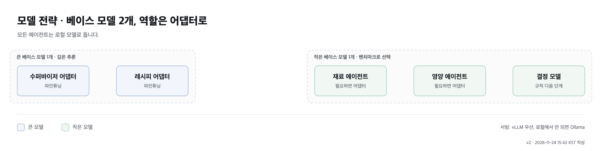
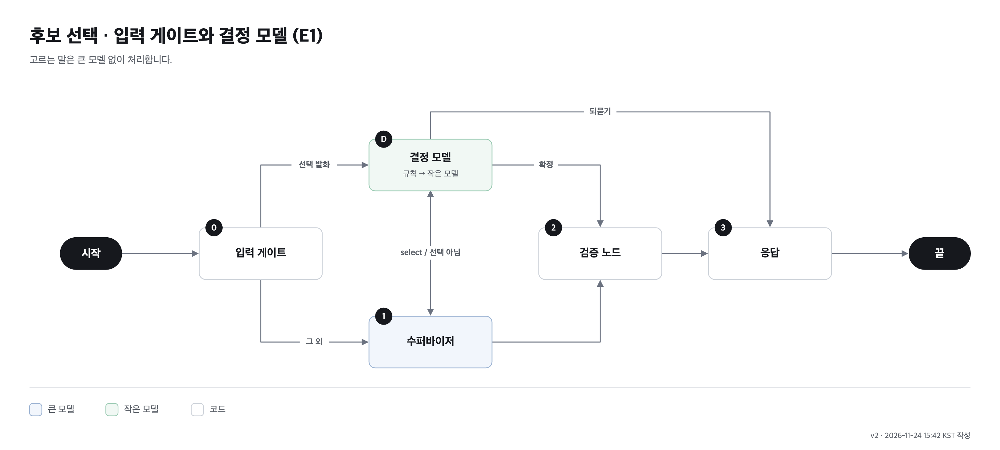
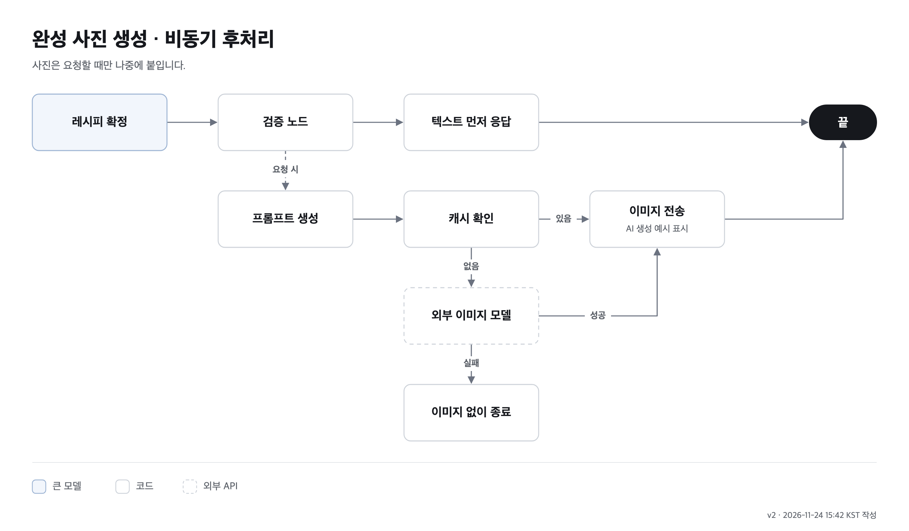
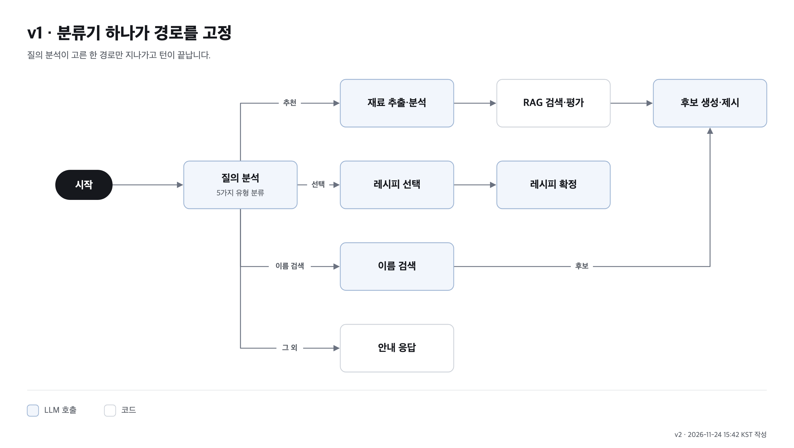
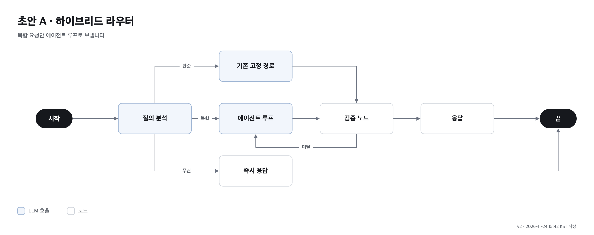
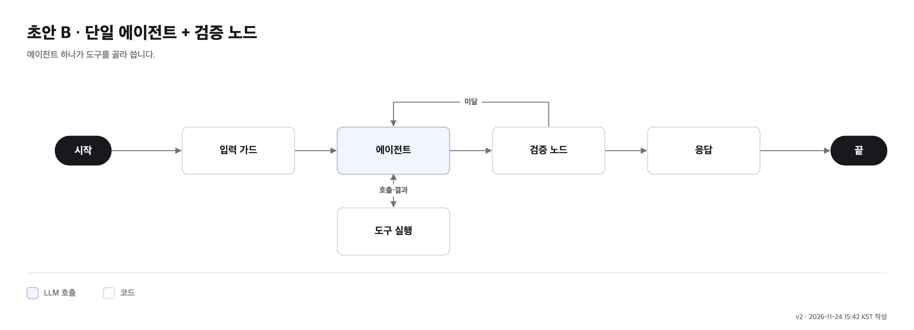
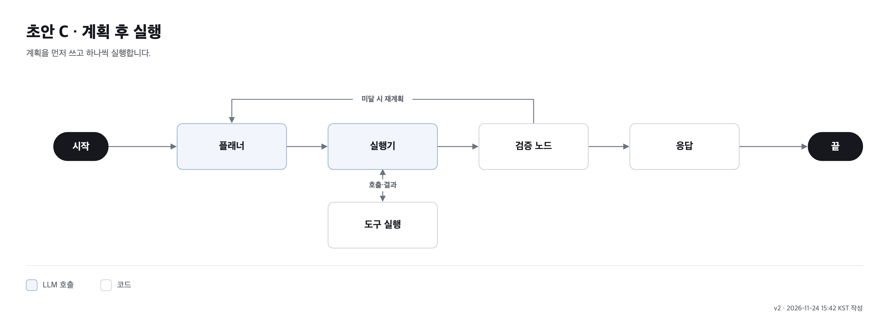
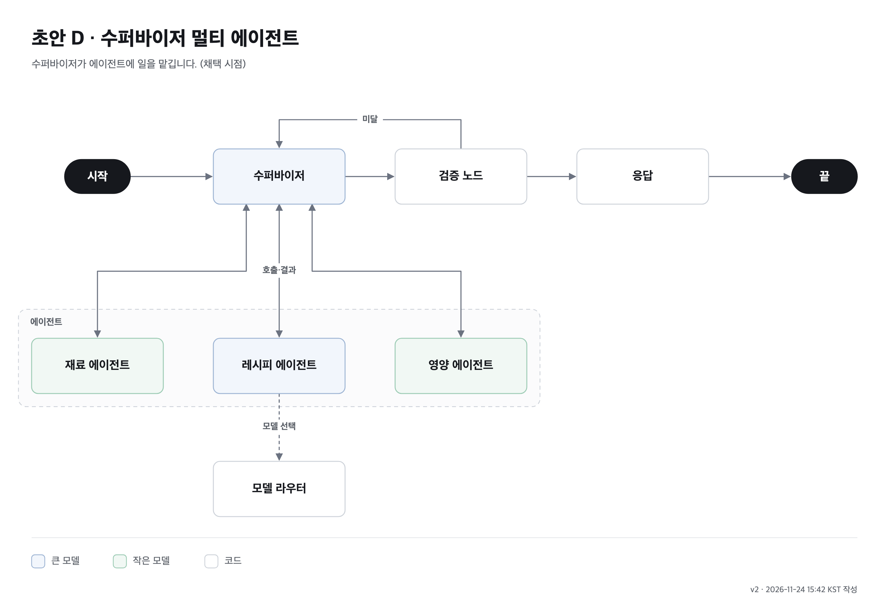

# 레시피 챗봇 v2 아키텍처 설계 기록

> 작성일: 2026-11-24
> 대상: `KTB4-emet-LLM-Application-Project` (레시피 챗봇 v1) → 레시피 챗봇 v2
> 목적: v1의 고정 LangGraph 구조가 v2에서 어떻게, 왜 바뀌었는지 남긴다.

## 요약

레시피 챗봇 v2는 v1의 고정 LangGraph 파이프라인을 수퍼바이저 멀티 에이전트 구조로 다시 만든 것이다. 수퍼바이저 멀티 에이전트는 총괄 에이전트(수퍼바이저)가 요청을 읽고 재료·레시피·영양 담당 에이전트에 일을 나눠 주는 구조다. 모든 에이전트는 로컬 모델로 돌린다. 큰 모델 1개와 작은 모델 1개를 두고, 역할별 차이는 어댑터(LoRA처럼 베이스 모델에 덧붙이는 작은 학습 가중치)로 만든다.

## 현재 결정 요약

| 결정 | 내용 | 근거 섹션 |
|---|---|---|
| 전체 구조 | 수퍼바이저 멀티 에이전트 (초안 D) | 2, 8.4 |
| 모델 배치 | 모두 로컬. 큰 모델 1개(수퍼바이저, 레시피) + 작은 모델 1개(재료, 영양, 후보 선택) + 역할별 어댑터 | 3 |
| 서빙 | vLLM 우선, 로컬에서 안 되면 Ollama | 3 |
| 검증 | 검증 노드는 LLM 없이 순수 코드 | 2.2 |
| 후보 선택 | 초안 E1 채택, 구현 완료. 코드 게이트 + 결정 모델 | 4 |
| 완성 사진 | 검토 중. 외부 이미지 모델 사용 (로컬 원칙의 예외), 기본 꺼짐 | 5 |
| 작업 계획 | [작업 계획](../roadmap.md)으로 분리 | 6 |

## 1. v2의 목표

| 목표 | 설명 |
|---|---|
| 동적 에이전트 | 요청 유형을 미리 고정하지 않는다. 에이전트가 필요한 도구와 순서를 스스로 고른다 |
| 로컬 모델 중심 하이브리드 | 여기서 하이브리드는 큰 모델과 작은 모델의 분담을 뜻한다. 깊은 추론은 큰 모델, 좁은 반복 작업은 작은 모델이 맡는다 |
| 영양소 데이터 연동 | 식약처 식품영양성분 DB로 영양 성분과 칼로리를 코드로 계산한다 |
| 레시피 변형(아렌지) | v1에서 기획만 하고 보류한 기능을 구현한다 |
| 완성 사진 생성 (검토 중) | 확정된 레시피의 완성 모습을 이미지로 보여준다 (5장) |

## 2. 현재 구조

### 2.1 구성 요소

| 구성 요소 | 역할 | 모델 | 도구 | v1 출처 |
|---|---|---|---|---|
| 수퍼바이저 | 의도 파악, 담당 배정, 결과 종합, 모호하면 되묻기 | 큰 모델 + 수퍼바이저 어댑터 | 에이전트 호출 | `query_analysis`, 분기 함수들 |
| 재료 에이전트 | 재료 추출·추가·삭제·교체, 정규화, 궁합 검사, 요리 가능 여부 | 작은 모델 (+ 필요 시 어댑터) | `update_pantry`, `normalize`, `check_combination` | `nodes/ingredients.py`, `ingredient_analysis`, `ingredient_synonyms.py`, `food_combination_matcher.py` |
| 레시피 에이전트 | RAG 검색, 이름 검색, 후보 생성, 최종 레시피, 아렌지 | 큰 모델 + 레시피 어댑터 | `search_recipes`, `search_dish_by_name`, `generate_recipe`, `finalize_recipe`, `modify_recipe` | `nodes/recipes.py`, `nodes/preview_recipes.py`, `nodes/name_search.py`, `rag/` |
| 영양 에이전트 | 영양 계산, 대체 재료 추천, 목표 대비 차이 설명 | 작은 모델 (+ 필요 시 어댑터) + 계산 코드 | `calc_nutrition`, `find_substitute` | 신규 (식약처 DB) |
| 입력 게이트 + 결정 모델 | 후보 목록 중 사용자가 고른 것 처리 (4장) | 코드 + 작은 모델 (`selector`) | — | `select_recipe_option` |
| 검증 노드 | 영양 목표, 궁합 경고, 알레르기·제약 검사. 미달이면 수퍼바이저로 되돌림 | 없음 (순수 코드) | — | `build_combination_warnings` + 신규 |
| 모델 라우터 | 에이전트별 베이스 모델과 어댑터 선택, 실패 처리, 호출 기록 | — | — | `llm.py` 확장 |

### 2.2 상태와 검증 원칙

- v1 `OverrallState`의 필드(재료 목록, 보여준 레시피 id와 제목, 완성 레시피 캐시)는 유지한다.
- 에이전트는 자기 담당 필드만 쓴다. 예: `ingredient_list`는 재료 에이전트만, `structured_recipe`는 레시피 에이전트만 쓴다.
- 도구는 LangGraph `Command`로 state를 바꾼다. 그래서 v1의 중복 방지 로직(`shown_rag_ids`, `shown_titles`)을 그대로 쓴다.
- 루프 횟수는 v1에서 쓰지 않던 `total_loop`을 살려 상한(N회)을 건다.
- 검증 노드는 LLM을 쓰지 않는다. v1의 동의어 사전과 궁합 검사를 순수 코드로 만든 것과 같은 이유다. 비용이 없고, 결과가 항상 같고, 에이전트가 결과를 마음대로 통과시키지 못한다.

## 3. 모델 전략 (2026-11-24 결정)

모든 에이전트를 기본적으로 로컬 모델로 운영한다. 베이스 모델은 큰 모델 1개, 작은 모델 1개만 둔다.

원본: [model-strategy.spec.json](../diagrams/model-strategy.spec.json)

| 베이스 | 맡는 에이전트 | 이유 | 진행 방식 |
|---|---|---|---|
| 큰 모델 1개 | 수퍼바이저, 레시피 | 의도 파악, 여러 단계 판단, 레시피 생성처럼 깊은 추론이 필요 | 파인튜닝으로 역할별 어댑터 제작 |
| 작은 모델 1개 | 재료, 영양, 후보 선택(`selector`) | 추출·정규화·계산 설명처럼 범위가 좁고 반복적 | v1 Ollama 결과와 작은 모델 후보를 벤치마크해서 선택. 프롬프트만으로 부족할 때만 어댑터 추가 |

장점:
- 같은 베이스를 쓰는 에이전트끼리 GPU 메모리를 공유한다. 큰 모델을 한 번만 띄워 수퍼바이저와 레시피 에이전트가 함께 쓴다.
- 어댑터는 작다. 역할을 추가하거나 다시 학습해도 베이스 모델은 그대로다.
- 클라우드 API 비용이 없다. 사용자 데이터가 외부로 나가지 않는다.

모델 라우터 정책 (초안):
1. 에이전트마다 `(베이스 모델, 어댑터)` 조합을 설정 파일로 지정한다. 예: `supervisor: (big, supervisor-lora)`, `ingredient: (small, null)`
2. `llm.py`의 `get_llm(provider, model)`에 `"local"` provider를 추가한다. 요청마다 어댑터 이름을 지정할 수 있게 한다.
3. 구조화 출력 검증(Pydantic)에 실패하면 같은 모델로 한 번 재시도한다. 또 실패하면 안전한 기본 응답을 낸다. 클라우드 폴백을 남길지는 미정이다 (7장).
4. 실패 횟수와 사유를 기록한다. 어댑터 재학습이 필요한 에이전트를 찾는 근거로 쓴다.

서빙 방식 (2026-11-24 결정): vLLM을 먼저 시도하고, 로컬 환경에서 안 되면 Ollama를 쓴다.
- 베이스 모델 하나에 여러 어댑터를 요청마다 바꿔 끼우려면 multi-LoRA 서빙 서버(예: vLLM)가 맞다.
- Ollama는 Modelfile의 `ADAPTER`로 어댑터별 모델을 만든다. 작은 모델 벤치마크와 개발 단계에 쓰기 좋다.

파인튜닝 데이터 출처 (후보):
- v1 대화 로그 (일별 로테이션, S3 아카이브)
- v1 LangSmith 트레이스 (`evaluate/export_langsmith_traces.py`)
- v1 기능 테스트·E2E 테스트 케이스. 학습용이 아니라 평가용으로 따로 보관한다.
- 수퍼바이저 어댑터는 도구 호출 형식을 배워야 한다. 그래서 에이전트 호출 순서가 담긴 트레이스 데이터가 따로 필요하다.

## 4. 후보 선택: 입력 게이트와 결정 모델 (초안 E1)

> 상태: 구현 (2026-11-24)

레시피 에이전트가 후보를 여러 개 내면, 번호 붙은 목록을 보여주고 턴을 끝낸다. 다음 턴의 선택 발화("2번", "계란말이로 할게")는 큰 모델 없이 처리한다. 입력 게이트는 선택 발화를 골라내는 코드 규칙이다. 결정 모델은 어느 후보를 골랐는지 정하는 규칙 + 작은 모델 단계다.

| 초안 | 구조 | 판단 |
|---|---|---|
| E1 코드 게이트 지름길 | 입구의 코드 게이트가 선택 발화를 결정 모델로 바로 보낸다 | 채택. 선택 발화에 큰 모델 호출 0회. 게이트가 틀려도 수퍼바이저가 받아준다 |
| E2 네 번째 에이전트 | 수퍼바이저가 "선택"이라고 판단하면 결정 노드를 부른다 | E1에 포함. 게이트가 놓친 선택은 수퍼바이저가 `select`로 넘긴다 |
| E3 1차 분류기 | 작은 모델이 모든 발화를 선택·재료 변경·그 외로 먼저 나눈다 | 보류. 작은 모델의 분류 정확도를 벤치마크로 확인한 뒤 재검토 |

원본: [selection-flow-e1.spec.json](../diagrams/selection-flow-e1.spec.json)

입력 게이트 규칙 (`selection.py`), 위에서부터 적용:
1. 직전에 보여준 후보 목록이 없으면 항상 수퍼바이저로 보낸다.
2. 30자를 넘거나, 재료 양("2개")·새 요청("다른")·조건("칼로리")·변형("맵게") 표현이 있으면 수퍼바이저로 보낸다.
3. 번호, 서수("첫 번째", "마지막"), 후보 제목, 선택 동사("할게", "줘") 중 하나가 있으면 결정 모델로 보낸다.

| 결정 모델 단계 | 동작 |
|---|---|
| 규칙 | 번호와 제목으로 후보를 정한다. "2번 말고 3번"은 "말고" 뒤쪽을 고른다. 겹치는 제목("김치볶음밥"과 "참치 김치볶음밥")은 더 긴 쪽을 고른다. 두 개 이상이면 되묻는다 |
| 작은 모델 | 규칙으로 못 정하면(축약어, 지시어) 작은 모델이 `OptionChoice`(선택인지, 몇 번인지)를 낸다. 에이전트 이름은 `selector`다 |
| 되묻기 | 그래도 모르면 후보 목록을 다시 보여주며 되묻는다. 선택이 아니라고 판단하면 수퍼바이저로 돌려보낸다 |
| 확정 후 | 영양은 코드로 바로 계산하고 검증 노드로 간다. 영양 에이전트(설명 생성)는 거치지 않는다 |

함께 바뀐 것:
- 레시피 에이전트 출력 `RecipeDraft`에 `alternatives`(최대 3개)를 추가했다. 비어 있으면 지금처럼 레시피 하나를 확정한다.
- 후보 목록 단계의 검증 노드는 알레르기처럼 바로 확인할 수 있는 조건으로만 후보를 거른다. 영양 조건은 고른 뒤에 확인한다.
- 보유 재료가 바뀌면 이전 후보 목록을 비운다.

## 5. 완성 사진 생성 (외부 모델, 로컬 원칙의 예외)

> 상태: 검토 중 (2026-11-24 추가)

확정된 레시피의 완성 모습을 이미지로 만들어 함께 보여준다. 이미지 생성은 판단이 아니라 "확정된 레시피 → 이미지" 변환이다. 그래서 에이전트로 두지 않고, 검증을 통과한 뒤 도는 비동기 후처리 단계로 둔다.

원본: [image-generation-flow.spec.json](../diagrams/image-generation-flow.spec.json)

- 프롬프트는 `StructuredRecipe`의 요리 이름, 주재료, 조리 방식으로 만든다. 한국 음식은 이름보다 생김새를 묘사하는 편이 정확하다. (예: "볶은 밥, 붉은 양념, 위에 반숙 계란, 검은 그릇")
- 이미지는 수 초에서 수십 초 걸린다. 레시피 텍스트를 먼저 보내고 이미지는 v1의 SSE 스트리밍으로 나중에 붙인다.
- 기본은 꺼둔다. 사용자가 "완성 사진 보기"를 눌렀을 때만 만든다.

외부 모델을 쓰는 이유:

| 이유 | 설명 |
|---|---|
| GPU 메모리 경쟁 회피 | 큰 LLM과 이미지 모델이 한 GPU를 나눠 쓰지 않는다. 로컬 GPU는 에이전트에만 쓴다 |
| 핵심 작업 집중 | v2의 핵심은 큰 모델 파인튜닝, 작은 모델 벤치마크, 영양 DB 연동이다. 이미지 모델 학습까지 하면 범위가 너무 넓다 |
| 교체가 쉬운 위치 | 에이전트 루프 밖의 후처리 단계다. 나중에 로컬로 바꿔도 다른 부분에 영향이 없다 |
| 빠른 가치 검증 | 학습 없이 바로 결과를 보고, 이 기능이 사용자에게 의미 있는지 먼저 확인한다 |

설계 원칙:
- 공통 인터페이스: `ImageGenerator.generate(recipe) -> image_url` 같은 인터페이스를 두고 제공사별 구현을 나눈다. v1 `llm.py`의 provider 구조와 같은 방식이다. 로컬로 옮길 때는 구현 하나만 추가한다.
- 캐싱: `recipe_id` 또는 제목과 재료로 만든 해시로 이미지를 저장하고 재사용한다.
- 실패 허용: 이미지 생성이 실패해도 레시피 응답은 정상으로 끝난다.
- AI 생성 표시: "AI가 생성한 예시 이미지이며 실제와 다를 수 있음"을 표시해 실제 사진으로 오해하지 않게 한다.
- RAG 출처 레시피: 원본 사이트에 실제 사진이 있으므로, 이미지 생성 대신 출처 링크로 연결하는 선택지도 둔다. 원본 사진을 복사해 보여주지는 않는다.
- 외부 전송 최소화: 프롬프트에는 레시피 정보만 넣는다. 사용자 원문 발화나 개인 정보는 넣지 않는다.

제공사 선정 방법:
- 한국 음식 10~20개(예: 김치볶음밥, 된장찌개, 잡채)로 후보 제공사 몇 곳을 비교한다.
- 비교 기준은 생김새 정확도, 이미지당 비용, 생성 시간, 생성물 이용 약관(상업적 이용 조건)이다.
- v1에서 Gemini API를 썼으므로, 같은 계정의 이미지 모델이 있는지도 확인한다.

로컬로 옮길 조건 (v3 후보). 아래 중 하나가 충족되면 다시 검토한다.
- GPU 여유가 생겨 LLM과 이미지 모델을 따로 돌릴 수 있을 때
- 월 이미지 생성 비용이 정해둔 기준을 넘을 때
- 학습 이용이 허용된 한국 음식 이미지 데이터(예: AI Hub 한국 음식 이미지)로 LoRA 어댑터를 학습할 준비가 됐을 때. 만개의 레시피 사진은 사용자 저작물이라 학습에 쓰지 않는다.

## 6. 진행 순서 (설계 시점 초안)

> 최신 작업 계획과 병행 구간은 [작업 계획](../roadmap.md)을 본다. 아래는 설계 시점의 초안이다.

1. 모델 라우터: `llm.py`에 `"local"` provider, 에이전트별 `(베이스, 어댑터)` 설정, 실패 기록을 추가한다.
2. 도구화: v1 노드 함수를 도구로 감싼다. 동작은 바꾸지 않는다.
3. 작은 모델 벤치마크: v1 Ollama 결과와 작은 모델 후보를 v1 기능 테스트 A(재료변경판단), C(재료명정규화)로 비교해 하나를 고른다.
4. 재료 에이전트를 고른 작은 모델로 붙인다. 프롬프트만으로 부족하면 어댑터를 학습한다.
5. 파인튜닝 데이터 준비: v1 로그와 트레이스로 수퍼바이저용, 레시피용 학습 데이터를 만든다.
6. 큰 모델 어댑터 학습: 수퍼바이저·레시피 어댑터를 학습하고 E2E 테스트로 v1과 비교한다.
7. 영양 에이전트: 식약처 DB를 받은 뒤 단위 변환 표, 매칭 로직, `calc_nutrition`을 만든다.
8. 검증 노드와 재시도 루프를 붙인다.
9. 아렌지 기능을 `modify_recipe`로 구현한다.
10. 완성 사진 생성: 제공사 벤치마크 후 `ImageGenerator` 인터페이스, 외부 제공사 구현, 캐시, 비동기 전송을 붙인다. 핵심 기능과 독립적이라 다른 단계와 병행할 수 있다.

## 7. 아직 정하지 않은 것

- 큰 베이스 모델과 작은 베이스 모델의 종류와 크기
- 모델 실행 위치 (개인 PC, GPU 서버, 클라우드 GPU). 서빙 방식은 정해졌다 (3장).
- 클라우드 모델의 역할: 완전히 없앨지, 학습 데이터 생성(교사 모델)이나 비상 폴백으로만 남길지
- 파인튜닝 방식 (LoRA / QLoRA)과 학습 환경
- 이미지 생성 제공사, 월 비용 기준, 생성 이미지 저장 위치
- 수퍼바이저를 LangGraph 그래프로 직접 짤지, 수퍼바이저용 라이브러리를 쓸지
- 영양소 데이터 형식과 저장 방식 (CSV / SQLite 등). 데이터는 아직 레포에 없다.
- 영양 목표 입력 방법 (대화 중 추출 / 설정 화면)

## 8. 배경: v1에서 초안 D까지

### 8.1 v1 구조와 한계

- `graph.py`의 `StateGraph`에 노드 20여 개가 고정된 경로로 연결되어 있다.
- 첫 노드 `query_analysis`가 질문을 5가지 유형(`레시피 추천`, `레시피 선택`, `레시피 이름 검색`, `NONETYPE`, `NONE`)으로 나누고 경로를 정한다.
- 한 턴에 한 경로만 지나고 끝난다. 되돌아가는 루프가 없다. `states.py`의 `total_loop` 필드는 선언만 되어 있다.

원본: [v1-graph.spec.json](../diagrams/v1-graph.spec.json)

v2로 가는 이유:
1. 분류기 하나가 입구를 지킨다. 여러 의도가 섞인 요청("땅콩 빼고 단백질 높게, 아까 그거 좀 맵게")도 한 유형으로만 처리한다.
2. 아렌지 기능이 막혔다. "대파 빼줘"가 재료 목록 변경인지 완성 레시피 수정인지 분류기로는 구분할 수 없다. (`docs/추후추가기능/20260807_2059_레시피_변형(아렌지)_기능_기획.md`)
3. 결과를 검토하고 다시 만드는 루프가 없다. 결과가 조건에 맞지 않아도 그대로 응답한다.
4. 영양 DB가 연결되지 않았다. README에 "DB(미사용)"으로 남아 있다.

### 8.2 v1에서 그대로 살릴 자산

LLM 없이 순수 코드로 동작하는 부분이다. v2에서 도구나 검증 로직으로 다시 쓴다.

| 자산 | 파일 | v2에서의 쓰임 |
|---|---|---|
| 재료명 동의어 정규화 | `ingredient_synonyms.py` | 재료 정규화, 영양 DB 매칭 키 |
| 재료 궁합 검사 | `food_combination_matcher.py`, `food_combination_taboo.json` | 궁합 검사 도구, 검증 노드 |
| RAG 적합성 평가 | `nodes/preview_recipes.py` (`evaluate_rag_options`) | 레시피 검색 도구 내부 |
| 구조화 출력 + 공급자 폴백 | `llm.py` (`invoke_structured`) | 모델 라우터로 확장 |
| 정형 레시피 스키마 | `schems.py` (`StructuredRecipe` 등) | 에이전트 간 데이터 계약 |
| SSE 스트리밍 | `main.py` | 그대로 유지 |
| 테스트 케이스 | `docs/기능테스트`, `docs/실제로직테스트` | v1 대비 퇴행 검사 세트 |

### 8.3 v1의 모델 사용 이력

| 시기 | 구성 | 바꾼 이유 |
|---|---|---|
| 초기 | Ollama 로컬 모델 | — |
| 배포 시 | Claude API로 전환 | EC2에 GPU 인스턴스를 띄우는 비용 부담 |
| 이후 | vLLM 제거, Gemini 폴백 추가 | 운영 단순화 |
| 베타테스트 | Gemini만 사용 (temperature 0.3) | API 한도와 품질 튜닝 |

`self_model/` 폴더와 `llm.py`의 `"self"` provider 자리는 로컬 모델 연동을 위해 남겨둔 흔적이다. v2는 여기서 다시 출발한다.

### 8.4 검토한 초안 A~D

> 이 비교는 클라우드 모델과 로컬 모델을 섞어 쓰는 안을 전제로 했다. 그림의 색 구분(클라우드 LLM이 판단하는 동적 부분 / 로컬 LLM이 맡는 부분 / 코드로 결정되는 고정 부분)과 표의 "로컬/클라우드 분담" 행이 그 전제를 따른다. 이후 모두 로컬로 정했다 (3장).

원본: [draft-a-hybrid-router.spec.json](../diagrams/draft-a-hybrid-router.spec.json)

원본: [draft-b-single-agent.spec.json](../diagrams/draft-b-single-agent.spec.json)

원본: [draft-c-plan-execute.spec.json](../diagrams/draft-c-plan-execute.spec.json)

원본: [draft-d-supervisor.spec.json](../diagrams/draft-d-supervisor.spec.json)

| | A 하이브리드 라우터 | B 단일 에이전트 + 검증 노드 | C 계획 후 실행 (Plan-and-Execute) | D 수퍼바이저 멀티 에이전트 (채택) |
|---|---|---|---|---|
| 구조 | v1 분류기를 유지하고 `QueryType`에 "복합 요청" 유형을 추가. 그 경로에만 에이전트 루프 | 분류기를 없애고 에이전트 하나가 도구 8개 정도를 골라 씀 | 플래너가 단계 계획을 세우고 실행기가 단계별로 도구 호출 | 수퍼바이저가 의도를 파악해 담당 에이전트에 맡기고 결과를 종합. 각 에이전트는 자기 도구만 가짐 |
| 장점 | 작업량이 가장 작음. 기존 테스트로 퇴행을 바로 확인 | 복합 요청을 자연스럽게 처리. 모호하면 에이전트가 직접 되물음 | 실행 과정이 투명해 진행 단계를 보여주기 좋음. 실패 지점 디버깅이 쉬움 | 에이전트마다 다른 모델을 붙일 수 있음. 프롬프트와 도구가 작아 작은 로컬 모델도 감당. 영역별로 따로 테스트·교체 |
| 단점 | 분류기가 입구를 계속 지켜 아렌지 모호성이 완전히 사라지지 않음 | 노드를 도구로 다시 묶는 작업량이 큼. 품질이 한 모델의 도구 호출 능력에 좌우됨. 모델이 하나라 분담이 어려움 | 단순 요청에도 플래너 호출이 붙어 느림. 짧게 주고받는 챗봇에는 무거움 | 에이전트 사이 호출이 늘어 지연과 비용 증가. 상태를 누가 쓰고 읽는지 계약을 명확히 해야 함 |
| 기존 코드 재사용 | 거의 전부 | 함수 단위 | 함수 단위 | 함수 단위 |
| 작업량 | 작음 | 큼 | 큼 | 가장 큼 |
| 복합 요청 처리 | 에이전트 경로만 | 강함 | 강함 | 강함 |
| 아렌지 모호성 해결 | 일부 | 해결 | 해결 | 해결 |
| 로컬/클라우드 분담 | 노드 단위로 가능 | 어려움 (모델 1개) | 플래너/실행기 2단 | 에이전트 단위로 자연스러움 |
| 응답 속도와 비용 | 단순 요청은 v1과 같음 | 늘어남 | 많이 늘어남 | 늘어남 (로컬로 일부 상쇄) |
| 모델 의존도 | 낮음 | 높음 | 중간 | 에이전트별로 분산 |

D를 고른 이유는 일을 맡는 모델을 역할별로 나누기 쉽다는 점이다. 당시 목표는 로컬과 클라우드의 하이브리드였고, 지금은 큰 로컬 모델과 작은 로컬 모델의 분담이다 (3장). 이 이유는 지금도 그대로 맞다.
- 모델 분담은 A~C에서도 노드 단위로 할 수 있다. 하지만 D는 "어떤 일을 어떤 모델이 맡는가"가 곧 에이전트 경계라서, 모델 배치가 구조에 드러난다.
- 재료 정규화, 영양 계산처럼 좁고 반복적인 일은 작은 모델로 충분하다. 의도 파악과 레시피 생성처럼 깊은 추론만 큰 모델에 맡긴다.
- 에이전트마다 프롬프트와 도구가 작아서, 성능이 낮은 로컬 모델에서도 구조화 출력 실패가 줄어든다.

## 부록

v1 → v2 노드 매핑

| v1 노드 | v2 위치 |
|---|---|
| `query_analysis`, `conditional_query_type` | 수퍼바이저 |
| `respond_undevopled`, `respond_unrealated`, `undeveloped` | 수퍼바이저의 직접 응답 |
| `reset_recipe_options`, `extract_ingredient`, `extract_ingredient_update`, `apply_ingredient_modification` | 재료 에이전트 `update_pantry` |
| `ingredient_analysis`, `respond_infeasible` | 재료 에이전트 (요리 가능 여부 판정) |
| `retreiver_recipes`, `rag_adequacy_check` | 레시피 에이전트 `search_recipes` |
| `preview_recipe_options`, `present_recipe_options` | 레시피 에이전트 `generate_recipe` + 수퍼바이저 응답 종합 |
| `finalize_recipe`, `fetch_rag_recipe` | 레시피 에이전트 `finalize_recipe` |
| `select_recipe_option`, `conditional_select_recipe_option` | 입력 게이트(코드) + 결정 모델 (4장). 처음에는 `select_recipe_option`을 `finalize_recipe`에 넣었으나 E1로 바뀜 |
| `search_by_name`, `filter_valid_candidates`, `judge_name_match`, `resolve_rag_name_match`, `generate_recipe_by_name` | 레시피 에이전트 `search_dish_by_name` |
| (없음) | 레시피 에이전트 `modify_recipe` (아렌지) |
| (없음) | 영양 에이전트 `calc_nutrition`, `find_substitute` |
| (없음) | 검증 노드 |
| (없음) | 완성 사진 생성 후처리 단계 (외부 이미지 모델) |

리스크와 대응

| 리스크 | 대응 |
|---|---|
| 로컬 모델의 구조화 출력 실패 | 에이전트별 스키마를 작게 유지하고, 재시도 후 안전한 기본 응답. 실패 기록을 재학습 근거로 사용 |
| 로컬 모델의 한국어 품질 | 한국어 성능이 검증된 모델 후보를 v1 테스트 세트로 비교한 뒤 선택 |
| 배포 비용 (v1에서 Ollama를 포기한 이유) | 모든 에이전트가 로컬이라 큰 모델용 GPU 환경이 필수. 실행 위치(개인 PC, GPU 서버, 클라우드 GPU)를 가장 먼저 정한다 |
| 파인튜닝 데이터 부족 | v1 로그와 트레이스를 정제하고, 부족한 유형은 합성 데이터로 보충. 평가 세트와 학습 세트를 반드시 분리 |
| 어댑터가 늘수록 관리가 복잡해짐 | 어댑터 이름에 베이스 모델과 버전을 넣고, 어댑터별 평가 결과를 함께 기록 |
| 이미지 생성 비용 증가 | 기본 꺼짐(요청 시에만 생성)과 캐싱. 월 비용 기준을 넘으면 로컬 전환 검토 |
| 생성 이미지와 레시피 불일치 (예: 뺀 알레르기 재료가 그려짐) | 처음에는 "AI 생성 예시" 표시. 이후 이미지-텍스트 일치도 검사(CLIP 계열) 검토 |
| 외부 이미지 서비스 장애와 호출 한도 | 실패하면 이미지 없이 응답을 끝내 핵심 기능에 영향이 없게 함 |
| 에이전트 간 호출로 인한 지연 | 의도가 분명한 단순 요청은 수퍼바이저가 한 에이전트에만 바로 맡기는 지름길을 둔다 |
| 무한 루프와 비용 폭주 | `total_loop` 상한, 턴당 토큰 예산 |
| v1 대비 품질 퇴행 | v1 기능 테스트 90개와 E2E 테스트를 v2에서 다시 실행해 비교 |
| 영양 계산의 단위 문제 | `공기`, `토막`, `큰술`, `개`, "약간"(-1)을 그램으로 바꾸는 변환 표를 코드로 작성. 매칭 실패는 "추정 제외"로 표시 |

## 변경 이력

| 날짜 | 내용 |
|---|---|
| 2026-11-24 | 최초 작성. v1 구조 분석, 초안 A~D 검토, 초안 D 채택 |
| 2026-11-24 | 모델 전략 결정: 모든 에이전트 로컬 기본. 큰 모델 1개(수퍼바이저, 레시피 어댑터 파인튜닝) + 작은 모델 1개(재료, 영양, 벤치마크로 선택) + 역할별 어댑터 |
| 2026-11-24 | 완성 사진 생성 기능 추가 (검토 중). 지금 단계는 외부 이미지 모델을 쓰는 로컬 원칙의 예외로 기록하고, 로컬 전환 조건 명시 |
| 2026-11-24 | 후보 선택 구조 초안 E1 채택과 구현 (4.7) |
| 2026-11-24 | 서빙 방식 결정: vLLM 우선, 로컬에서 안 되면 Ollama. 작업 계획을 `docs/roadmap.md`로 분리 |
| 2026-11-24 | 가독성 개선: 요약과 현재 결정을 앞으로, 중복 제거 |
