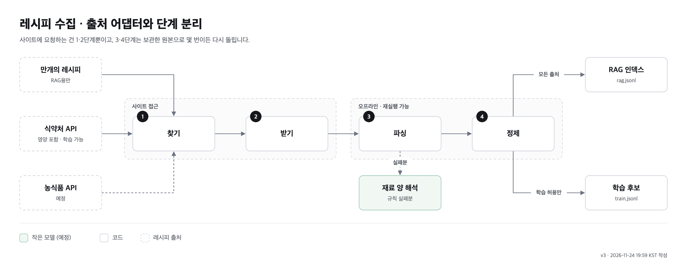

# 레시피 수집

RAG 검색 인덱스와 레시피 어댑터 학습에 쓸 레시피를 모읍니다. v1 크롤러를 고쳐 만들었습니다. 고친 방향은 세 가지입니다.

- **HTML 직접 파싱**: PDF와 LLM을 거치지 않고 페이지의 구조화 데이터를 읽습니다.
- **단계 분리**: 원본을 보관해 두고 단계마다 따로 실행합니다.
- **여러 출처와 이용 범위 표시**: 출처마다 어댑터를 두고, 레코드마다 어디에 써도 되는지 표시합니다.



| 번호 | 단계 | 하는 일 | 사이트 요청 |
|---|---|---|---|
| 1 | 찾기 | 새 레시피 id를 상태표에 기록 | 목록 페이지 |
| 2 | 받기 | 원본을 gzip으로 보관 | 레시피 페이지 |
| 3 | 파싱 | 원본을 공통 형식으로 바꾸고, 재료 줄을 이름·양·단위·그램으로 나눔 | 없음 |
| 4 | 정제 | 품질 거르기, 중복 제거, 용도별 분리 | 없음 |

## 출처

| 출처 | 어댑터 | 받는 방법 | 이용 범위 | 상태 |
|---|---|---|---|---|
| 만개의 레시피 | `10000recipe` | 검색 목록 → 레시피 페이지 HTML의 JSON-LD | RAG만 (출처 링크 표시). 사용자 저작물이라 학습·재배포 안 함 | 동작 확인 |
| 식약처 조리식품 레시피 DB | `foodsafety` | Open API `COOKRCP01` (1인분 영양 정보 포함) | RAG와 학습 | API 키 받은 뒤 확인 |
| 농식품 레시피 기본·재료·과정 정보 | — | Open API | RAG와 학습 | 예정 (L.4.6) |

이용 범위는 어댑터가 레코드마다 `usage`로 붙입니다. 정제 단계는 이 값만 보고 `rag.jsonl`과 `train.jsonl`을 나눕니다. 공공데이터 두 곳의 이용 조건은 API 키를 받을 때 다시 확인합니다.

## 실행

```bash
# 1. 찾기: 검색어마다 목록 2페이지 (페이지당 약 40개)
uv run python -m recipe_chatbot.ingest discover 10000recipe --keywords 잡채,갈비찜
uv run python -m recipe_chatbot.ingest discover 10000recipe --random 10   # 키워드 목록에서 무작위 10개

# 2. 받기: 남은 것 중 50개 (레시피마다 5초 대기, 약 4분)
uv run python -m recipe_chatbot.ingest fetch 10000recipe --limit 50

# 3. 파싱 (규칙을 바꿨으면 --reparse로 보관한 원본에서 다시)
uv run python -m recipe_chatbot.ingest parse 10000recipe

# 4. 정제: data/ingest/out/에 rag.jsonl, train.jsonl, report.json
uv run python -m recipe_chatbot.ingest build

# 진행 현황
uv run python -m recipe_chatbot.ingest status
```

식약처 API는 키를 `FOODSAFETY_API_KEY` 환경 변수에 넣고 `discover foodsafety`만 실행합니다. 목록 응답에 원본이 함께 오기 때문에 받기 단계가 필요 없습니다.

모든 결과는 `data/ingest/`에 쌓입니다. 이 폴더는 git에서 무시합니다.

| 경로 | 내용 |
|---|---|
| `manifest.sqlite` | 레시피마다 어느 단계까지 왔는지 (listed, fetched, parsed, failed, skipped) |
| `raw/<출처>/<id>.<형식>.gz` | 받은 원본 |
| `parsed/<출처>/<id>.json` | 공통 형식 (`SourceRecipe`) |
| `out/` | 정제 결과 |

## 지키는 규칙

- **요청 간격**: v1과 같습니다. 만개의 레시피는 목록 2.5초, 레시피 5초를 기다립니다. 줄이지 않습니다.
- **User-Agent**: `personal-research-script`를 붙여 개인 연구용 스크립트임을 밝힙니다.
- **멈춤**: 받기가 연속 5번 실패하면 차단으로 보고 멈춥니다. 목록이 비면 그 검색어는 끝냅니다.
- **이어 하기**: 상태표를 보고 남은 것만 처리합니다. 끊겨도 다시 실행하면 이어집니다.
- **원본 비공개**: 원본과 파싱 결과는 레포에 커밋하지 않습니다.

## 정제 규칙

| 규칙 | 값 |
|---|---|
| 최소 재료 수 | 2개 |
| 최소 조리 단계 | 2개 |
| 해석 못 한 재료 줄 | 절반 넘으면 버림 |
| 중복 판단 | 제목(띄어쓰기 무시)과 정규화한 재료 이름 집합이 같음 |
| 중복일 때 남기는 쪽 | 학습 가능 출처, 그다음 평가 수가 많은 쪽 |

`report.json`에는 두 가지 수가 함께 남습니다.
- **해석 못 한 재료 줄 수**: 이 줄들은 나중에 작은 모델로 해석할 대상입니다.
- **재료 양이 하나도 없는 레시피 수**: 원본에 양이 없는 레시피입니다. 검색에는 쓰고, 학습에서는 거를 후보입니다.

## v1과 달라진 점

| | v1 | v2 |
|---|---|---|
| 구조화 | 페이지 → PDF → 글자 추출 → 외부 LLM | HTML의 JSON-LD를 코드로 읽음 |
| 브라우저 | Playwright | 일반 HTTP (`httpx`) |
| 이어 하기 | 메모리에만 기록하고, `recipe_ids.json`을 키워드마다 덮어씀 | SQLite 상태표 |
| 재가공 | 다시 크롤링 | 보관한 원본으로 `--reparse` |
| 추가 정보 | 없음 | 평점, 평가 수, 작성일, 그램 표기, 영양 정보(식약처) |
| 용도 구분 | 없음 | 레코드마다 `usage` (RAG, 학습) |

v1 원본 코드는 v1 레포의 `data_pipeline/`에 있습니다(커밋 `894f3a6`). v1이 모은 레시피는 ID 80개, 구조화 28개였고, 모두 "볶음밥" 검색 결과였습니다.

## 확인한 것 (2026-11-24)

- **실제 사이트**: "잡채" 목록 1페이지에서 새 id 40개를 찾았습니다. 그중 3개를 받아 파싱했고, 실패는 0개였습니다.
  - 재료 줄은 모두 해석됐습니다. 예: `당면 300g` → 당면, 300, g, 300g.
  - 한 레시피는 원본 페이지에도 재료 양이 없었습니다. `report.json`의 재료 양이 없는 레시피 수가 1로 나왔습니다.
- **테스트**: 가짜 HTTP와 직접 만든 원본으로 `tests/test_ingest.py`를 돌립니다. 사이트에는 요청하지 않습니다.
