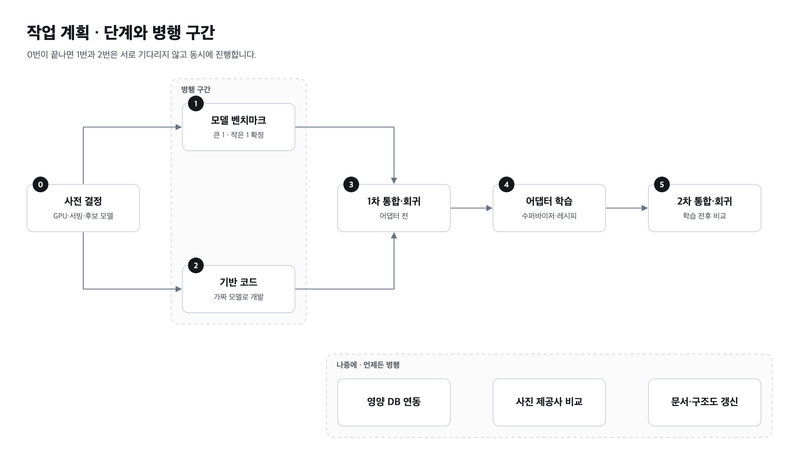

# 레시피 챗봇 v2 작업 계획

> 작성일: 2026-11-24 · 상태: 초안
> 설계 배경은 [v2 아키텍처 설계 기록](architecture/recipe-chatbot-v2-architecture.md)을 봅니다.
> 업무별 진행 상황과 날짜는 [업무 플로우](workflow.md)에 기록합니다.

## 요약

레시피 챗봇 v2를 만드는 작업 계획입니다. 0번 사전 결정을 먼저 끝내고, 1번 모델 벤치마크와 2번 기반 코드는 서로 기다리지 않고 동시에 진행합니다. 둘이 끝나면 3번 1차 통합·회귀 검증, 4번 어댑터 학습, 5번 2차 통합·회귀 검증을 차례로 진행합니다.

핵심 결정은 두 가지입니다.

- 서빙은 vLLM을 먼저 시도합니다. 로컬 환경에서 안 되면 Ollama로 바꿉니다.
  - 실행 환경이 Mac이라 지금은 Ollama를 씁니다. LoRA 학습은 데스크톱(RTX 3050)에서 합니다.
- 어댑터 학습은 벤치마크와 1차 통합 뒤에 합니다. 같은 평가 세트로 재야 학습 전후를 비교할 수 있기 때문입니다.

## 흐름

아래는 단계 수준의 그림입니다. `병행 구간` 안의 1번과 2번은 동시에 진행합니다.

원본: [roadmap-flow.spec.json](diagrams/roadmap-flow.spec.json)

## 작업 목록

`추가` 표시는 검토에서 더한 작업입니다.

### 0. 사전 결정 `추가`

| 번호 | 작업 | 내용 |
|---|---|---|
| 0.1 | 실행 환경 | **벤치마크·개발은 Mac(M2, 16GB, Ollama), LoRA 학습은 데스크톱(RTX 3050, QLoRA)** |
| 0.2 | 서빙 방식 | **vLLM 우선, 로컬에서 안 되면 Ollama** |
| 0.3 | 후보 모델 | 선정 기준(라이선스, 한국어 성능, VRAM 크기, 도구 호출 지원)과 후보 목록 |

### 1. 베이스 모델 벤치마크 (큰 모델과 작은 모델)

| 번호 | 작업 | 내용 |
|---|---|---|
| 1.1 | 테스트·검증 데이터셋 구하기 또는 생성 | 에이전트 역할별 구성 (아래 참고) |
| 1.2 | v1 로그 익명화 `추가` | 실제 사용자 발화의 개인정보 제거 (사용 전) |
| 1.3 | 데이터셋 검증 | 라벨 정확성, 중복, 역할별 분포 |
| 1.4 | 평가 세트 동결 `추가` | 검증된 평가 세트 고정. 4번 학습 데이터와 혼용 금지 |
| 1.5 | 평가 지표 정의 `추가` | 구조화 출력 성공률, 정확도, 첫 토큰까지 시간, 초당 토큰, VRAM 사용량. 레시피 품질은 LLM 심사 + 사람 일부 확인 |
| 1.6 | 데이터셋을 통한 테스트 및 검증 | 후보 모델별 실행. v1 Gemini 결과를 기준선으로 함께 측정 `추가` |
| 1.7 | 최종 벤치마크 | 큰 모델 1개, 작은 모델 1개 확정 |
| 1.8 | 과정·결과 정리 md | 방법, 데이터, 지표, 결과, 선택 이유 |

1.1 데이터셋은 에이전트 역할별로 나눕니다.

- 수퍼바이저: 의도 분류·배정
- 레시피: 생성 품질
- 재료: 추출·정규화
- 영양: 설명 품질

출처는 v1 기능 테스트 90개·E2E 40개, v1 로그·트레이스, 합성 데이터입니다.

### 2. 기반 코드

| 번호 | 작업 | 내용 |
|---|---|---|
| 2.1 | 프로젝트 골격 `추가` | uv 의존성 관리, 테스트 프레임워크, lint, GitHub Actions, `.env.example` |
| 2.2 | 인터페이스 계약 `추가` | 상태(State) 스키마, 도구 시그니처, 모델 라우터 `(베이스 모델, 어댑터)`, `ImageGenerator` |
| 2.3 | 핵심 코드 설계 및 생성 | |
| 2.3.1 | 변수 및 함수 정의 | 수퍼바이저, 에이전트 A·B·C, 검증 노드, 응답 |
| 2.3.2 | 가짜 모델 라우터 `추가` | 고정 응답 반환. 벤치마크 완료 전 개발·테스트용 |
| 2.3.3 | v1 자산 이식 `추가` | 동의어 사전, 궁합 검사, 정형 레시피 스키마 (⚠️ 아래 참고) |
| 2.3.4 | 트레이싱 `추가` | 에이전트 호출 순서 기록. 디버깅 및 4.1 학습 데이터 출처 |
| 2.3.5 | 기능 테스트 | 노드·도구 단위 테스트 |
| 2.3.6 | 성능 테스트 | 필요 시 진행 |
| 2.4 | 후보 선택 흐름 (초안 E1) `추가` | 입력 게이트(코드)와 결정 모델(규칙 → 작은 모델 → 되묻기). 설계 기록 4장 |

⚠️ 2.3.3: 만개의 레시피 원본과 구조화 데이터는 공개 레포에 넣지 않습니다. 레포 밖이나 비공개 저장소에 둡니다.

### 3. 1차 통합·회귀 검증 (어댑터 전) `추가`

- 1.7에서 확정한 베이스 모델을 기반 코드에 연결합니다.
- v1 테스트(기능 90개, E2E 40개)를 다시 돌려 v1과 비교합니다.
- 이 결과가 어댑터 **학습 전** 기준이 됩니다.

### 4. 어댑터 학습

벤치마크와 1차 통합 이후에 진행합니다.

| 번호 | 작업 | 내용 |
|---|---|---|
| 4.1 | 학습 데이터 구축 | v1 로그·트레이스 정제, 부족한 유형은 합성. 1.4 평가 세트와 분리 |
| 4.2 | LoRA 학습 | 수퍼바이저 어댑터, 레시피 어댑터 |
| 4.3 | 학습 전후 비교 | 1.4 평가 세트로 베이스 모델 대비 개선 측정 |

### 5. 2차 통합·회귀 검증 (어댑터 후) `추가`

- 어댑터를 적용한 상태로 3번과 같은 회귀 검증을 다시 돌립니다.
- 이로써 시스템 전체의 학습 전후를 비교합니다.

### 나중에 · 언제든 병행

| 작업 | 내용 |
|---|---|
| 영양 DB 연동 | 식약처 DB 다운로드, 단위→그램 변환표, 매칭 로직 |
| 완성 사진 제공사 벤치마크 | 한국 음식 10~20개로 제공사 비교 |
| 설계 문서·구조도 갱신 | 결정 변경 시 `spec-figure` 명세로 함께 갱신 |

## 변경 이력

| 날짜 | 내용 |
|---|---|
| 2026-11-24 | 가독성 개선: 요약을 앞으로, 표 문장 줄임 |
| 2026-11-24 | 2.4 후보 선택 흐름(E1) 추가 |
| 2026-11-24 | 최초 작성. 벤치마크·기반 코드 두 축에 사전 결정, 1·2차 통합 검증, 어댑터 학습, 보강 작업 추가 |
