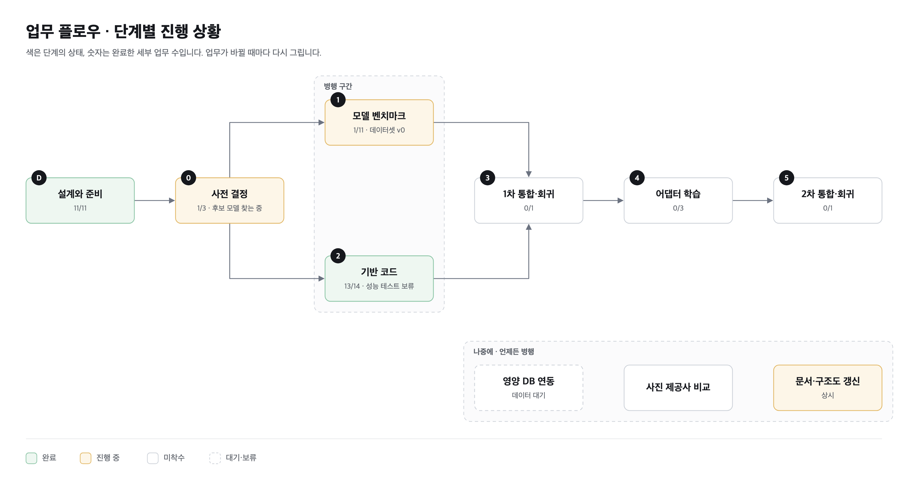

# 레시피 챗봇 v2 업무 플로우

**요약**: 설계(D)는 끝났고 기반 코드(2)는 보류한 성능 테스트만 남았습니다. 지금은 후보 모델 찾기(0.3)와 벤치마크용 평가 데이터 수집(1.1, v0 97개)을 진행하고 있습니다. 실행 환경(0.1)은 Mac 벤치마크·데스크톱 학습으로 정했습니다. 합성 데이터(1.1.2)와 벤치마크 실행기(1.5)는 검토 대기입니다. 어댑터 학습(4)과 통합 검증(3, 5)은 아직 시작 전입니다.

마지막 갱신: 2026-11-25

> **보드**: [① 업무](https://github.com/users/Sen-Yu/projects/1) · [② 데일리 스크럼](https://github.com/users/Sen-Yu/projects/2) · [③ 주간 스크럼](https://github.com/users/Sen-Yu/projects/3) · [마일스톤](https://github.com/Sen-Yu/recipe-chatbot-v2/milestones) — 열린 업무마다 이슈가 있고, 지금 상태는 업무 보드 칸(결정 필요 · 할 일 · 진행 중 · 새벽 작업 · 검토 대기 · 완료)으로 봅니다. 로드맵 단계는 마일스톤입니다. 이 문서는 단계 계획, 날짜, 결과, 변경 이력을 남깁니다.

## 한눈에 보기

| 단계 | 완료 | 진행 중 | 대기·보류·미착수 | 진행률 |
|---|---|---|---|---|
| D. 설계와 준비 | 15 | 0 | 0 | 100% |
| 0. 사전 결정 | 2 | 1 | 0 | 67% |
| 1. 베이스 모델 벤치마크 | 1 | 1 | 9 | 9% |
| 2. 기반 코드 | 14 | 0 | 1 | 93% |
| 3. 1차 통합·회귀 검증 | 0 | 0 | 1 | 0% |
| 4. 어댑터 학습 | 0 | 0 | 3 | 0% |
| 5. 2차 통합·회귀 검증 | 0 | 0 | 1 | 0% |
| 나중에 · 언제든 병행 | 0 | 2 | 2 | — |

**지금 하고 있는 일**
- 0.3 후보 모델 찾기 (사용자)
- 밤사이 작업 (Claude, 모두 끝남 · 검토 대기): 레시피 3,000개 수집(L.4.9), 벤치마크 실행기(1.5), 평가 데이터 보강(1.1.2), RAG 인덱스(L.5)
- 설계 문서·구조도 갱신 (상시)

**다음에 할 수 있는 일**
- 0.3 후보 모델 확정 (Mac 16GB·RTX 3050 조건)
- Mac에 Ollama 설치, 작은 모델로 벤치마크 흐름 시험

> 이 문서는 업무 진행 상황을 기록하며, 업무가 시작·종료되거나 새로 생길 때마다 바로 고칩니다.
> 업무의 순서와 이유는 [작업 계획](roadmap.md)에, 설계 배경은 [설계 기록](architecture/recipe-chatbot-v2-architecture.md)에 있습니다.

## 전체 흐름

색은 단계의 상태를 뜻합니다. 초록은 완료, 노랑은 진행 중, 흰색은 미착수, 점선은 대기·보류입니다. 숫자는 완료한 세부 업무 수입니다.

원본: [workflow-status.spec.json](diagrams/workflow-status.spec.json)

## 상태 표시

| 상태 | 뜻 |
|---|---|
| 완료 | 끝났고 결과가 남아 있음 |
| 진행 중 | 지금 하고 있음 |
| 대기 | 앞 업무나 외부 조건(데이터, 결정)을 기다림 |
| 보류 | 일부러 미룸. 사유를 결과 칸에 적음 |
| 미착수 | 아직 시작하지 않음 |

담당은 `사용자`(직접 진행), `Claude`(이 세션에서 진행), `함께` 중 하나로 적습니다.

## 세부 업무

### 0. 사전 결정

| 번호 | 업무 | 상태 | 담당 | 시작 | 종료 | 업무 내용 | 업무 결과 |
|---|---|---|---|---|---|---|---|
| 0.1 | 실행 환경 결정 | 완료 | 사용자 | 2026-11-25 | 2026-11-25 | 모델을 돌릴 GPU 환경(개인 PC, GPU 서버, 클라우드 GPU) 결정 | 벤치마크·개발은 Mac(M2, 16GB, Ollama), LoRA 학습은 데스크톱(RTX 3050, QLoRA). 설계 기록 3장 |
| 0.2 | 서빙 방식 결정 | 완료 | 사용자 | 2026-11-24 | 2026-11-24 | vLLM과 Ollama 중 선택 | vLLM 우선, 로컬에서 안 되면 Ollama. 설계 기록 3장 |
| 0.3 | 후보 모델 찾기 | 진행 중 | 사용자 | 2026-11-24 | | 라이선스, 한국어 성능, VRAM 크기, 도구 호출 지원 기준으로 큰 모델·작은 모델 후보 선정 | |

### 1. 베이스 모델 벤치마크

| 번호 | 업무 | 상태 | 담당 | 시작 | 종료 | 업무 내용 | 업무 결과 |
|---|---|---|---|---|---|---|---|
| 1.1 | 역할별 데이터셋 수집·생성 | 진행 중 | Claude | 2026-11-24 | | 수퍼바이저, 레시피, 재료, 영양 역할별 평가 데이터. 출처: v1 테스트, v1 로그·트레이스, 합성 데이터 | v0 97개 (선택 21개 포함). 목표 300개 중 나머지는 1.1.2, 1.1.3 대기 |
| 1.1.1 | v1 테스트 변환과 형식 정의 `추가` | 완료 | Claude | 2026-11-24 | 2026-11-24 | 역할별 케이스 형식 정의, v1 기능·E2E·웹검색 테스트를 v2 동작 기준 정답으로 변환, 형식 검사 테스트 | `data/eval/v0/` 4개 파일 76케이스, [데이터셋 설명](../data/eval/README.md), `evalset.py`, 테스트 4개 |
| 1.1.2 | 합성 데이터 생성 `추가` | 완료 | Claude | 2026-11-24 | 2026-11-24 | 역할별 부족분을 합성으로 채움 (목표 300개) | v1 304개 (v0 97 + Claude 작성 207). `feat/benchmark` 브랜치 (`d6084b5`, 로컬). 정답대로 답하는 가짜 모델로 채점·데이터 일치 확인, 입력 게이트 규칙 1개 보완. 사람 검토는 1.3에서 |
| 1.1.3 | v1 대화 로그 반영 `추가` | 대기 | | | | 실제 사용자 발화를 케이스로 추가 | v1 로그(S3) 전달과 1.2 익명화 후 진행 |
| 1.2 | v1 로그 익명화 `추가` | 미착수 | | | | 실제 사용자 발화에서 개인정보 제거 | |
| 1.3 | 데이터셋 검증 | 미착수 | | | | 라벨 정확성, 중복, 역할별 분포 확인 | |
| 1.4 | 평가 세트 동결 `추가` | 미착수 | | | | 평가 세트를 고정하고 어댑터 학습 데이터와 분리 | |
| 1.5 | 평가 지표 정의 `추가` | 완료 | Claude | 2026-11-24 | 2026-11-24 | 구조화 출력 성공률, 정확도, 응답 시간, VRAM, 레시피 품질. 지표 문서와 벤치마크 실행기 | `feat/benchmark` 브랜치 (`50e29e5`, 로컬). 실행기 `src/recipe_chatbot/benchmark/`, 지표·기준 문서 `docs/benchmark.md`. 가짜 모델로만 확인 |
| 1.6 | 테스트 및 검증 | 미착수 | | | | 후보 모델별 실행, v1 Gemini 기준선 포함 | |
| 1.7 | 최종 벤치마크 | 미착수 | | | | 큰 모델 1개, 작은 모델 1개 확정 | |
| 1.8 | 과정·결과 정리 md | 미착수 | | | | 방법, 데이터, 지표, 결과, 선택 이유 | |

### 2. 기반 코드

| 번호 | 업무 | 상태 | 담당 | 시작 | 종료 | 업무 내용 | 업무 결과 |
|---|---|---|---|---|---|---|---|
| 2.1 | 프로젝트 골격 `추가` | 완료 | Claude | 2026-11-24 | 2026-11-24 | uv(Python 3.14), pytest, ruff, GitHub Actions, `.env.example` | `pyproject.toml`, `uv.lock`, `.github/workflows/ci.yml` |
| 2.2 | 인터페이스 계약 `추가` | 완료 | Claude | 2026-11-24 | 2026-11-24 | 에이전트 간 스키마, 그래프 상태, 모델 라우터, `ImageGenerator` | `schemas.py`, `state.py`, `models.py`, `images.py` |
| 2.3.1 | 변수 및 함수 정의 | 완료 | Claude | 2026-11-24 | 2026-11-24 | 수퍼바이저, 재료·레시피·영양 에이전트, 검증, 응답 노드와 그래프 조립 | `nodes.py`, `graph.py`, `prompts.py` |
| 2.3.2 | 가짜 모델 라우터 `추가` | 완료 | Claude | 2026-11-24 | 2026-11-24 | 스키마별로 정해진 응답을 돌려주는 가짜 모델 | `models.py` `FakeChatClient` |
| 2.3.3 | v1 자산 이식 `추가` | 완료 | Claude | 2026-11-24 | 2026-11-24 | 재료명 정규화, 성분 카테고리, 궁합 검사 이식. 레시피 원본 데이터는 옮기지 않음 | `src/recipe_chatbot/domain/` |
| 2.3.4 | 트레이싱 `추가` | 완료 | Claude | 2026-11-24 | 2026-11-24 | 노드·모델 호출 순서와 출력 기록 | `tracing.py` |
| 2.3.5 | 기능 테스트 | 완료 | Claude | 2026-11-24 | 2026-11-24 | 가짜 모델로 전체 흐름, 재시도, 되묻기, 라우팅 검증 | 테스트 27개 통과, CI 통과. [PR #1](https://github.com/Sen-Yu/recipe-chatbot-v2/pull/1) 머지 (`6df8949`) |
| 2.3.6 | 성능 테스트 | 보류 | | | | 필요하다면 진행 | 실제 모델이 있어야 의미가 있어 3번(1차 통합)에서 함께 진행 |
| 2.4 | 레포 정리 `추가` | 완료 | Claude | 2026-11-24 | 2026-11-24 | 머지된 `feat/base-code` 브랜치를 로컬과 GitHub에서 삭제 | `main`만 남음 |
| 2.5 | 선택 흐름 설계 (초안 E1) `추가` | 완료 | 함께 | 2026-11-24 | 2026-11-24 | 레시피 후보 목록 선택을 결정 모델이 맡는 구조 비교 (E1 코드 게이트 지름길, E2 네 번째 에이전트, E3 1차 분류기) | E1 채택: 입력 게이트(코드) → 결정 모델(규칙 → 작은 모델 → 되묻기) |
| 2.6 | 입력 게이트와 결정 모델 구현 `추가` | 완료 | Claude | 2026-11-24 | 2026-11-24 | 선택 발화 판별 규칙, 결정 노드, 수퍼바이저의 선택 경로 | `selection.py`, `nodes.py`(decide), 작은 모델 에이전트 `selector` 추가 |
| 2.7 | 후보 목록 흐름 `추가` | 완료 | Claude | 2026-11-24 | 2026-11-24 | 레시피 에이전트가 후보 여러 개를 내고, 검증·응답이 목록을 다룸 | `RecipeDraft.alternatives`, 검증의 후보 거르기, 번호 목록 응답 |
| 2.8 | 선택 평가 데이터와 테스트 `추가` | 완료 | Claude | 2026-11-24 | 2026-11-24 | v1 선택 케이스와 헷갈리는 비선택 발화로 평가 데이터 "선택" 역할 추가 | `data/eval/v0/selection.jsonl` 21개, `tests/test_selection.py`. 전체 테스트 74개 통과 |
| 2.9 | 설계 문서·구조도 반영 `추가` | 완료 | Claude | 2026-11-24 | 2026-11-24 | 설계 기록, 작업 계획, README 구조도에 E1 반영 | 설계 기록 4장, 로드맵 2.4, README 구조도·노드 표. `spec-figure` 스킬에 지름길(점선) 화살표 추가 |
| 2.10 | 선택 흐름·문서 정리 PR `추가` | 완료 | Claude | 2026-11-24 | 2026-11-24 | 2.5~2.9, 1.1.1, D.10~D.14 커밋을 PR 하나로 `main`에 올림 | [PR #2](https://github.com/Sen-Yu/recipe-chatbot-v2/pull/2) 머지 (`edcf498`). 머지된 브랜치 삭제 |

### 3. 1차 통합·회귀 검증 (어댑터 전)

| 번호 | 업무 | 상태 | 담당 | 시작 | 종료 | 업무 내용 | 업무 결과 |
|---|---|---|---|---|---|---|---|
| 3.1 | 베이스 모델 연결과 회귀 검증 | 미착수 | | | | 1.7에서 확정한 모델을 연결하고 v1 테스트(기능 90개, E2E 40개)로 v1과 비교. 2.3.6 성능 테스트 포함 | |

### 4. 어댑터 학습

| 번호 | 업무 | 상태 | 담당 | 시작 | 종료 | 업무 내용 | 업무 결과 |
|---|---|---|---|---|---|---|---|
| 4.1 | 학습 데이터 구축 | 미착수 | | | | v1 로그·트레이스 정제, 합성 보충. 1.4 평가 세트와 분리 | |
| 4.2 | LoRA 학습 | 미착수 | | | | 수퍼바이저 어댑터, 레시피 어댑터 | |
| 4.3 | 학습 전후 비교 | 미착수 | | | | 1.4 평가 세트로 베이스 모델 대비 개선 측정 | |

### 5. 2차 통합·회귀 검증 (어댑터 후)

| 번호 | 업무 | 상태 | 담당 | 시작 | 종료 | 업무 내용 | 업무 결과 |
|---|---|---|---|---|---|---|---|
| 5.1 | 어댑터 적용 회귀 검증 | 미착수 | | | | 3.1과 같은 검증을 어댑터 적용 상태로 다시 실행해 비교 | |

### 나중에 · 언제든 병행

| 번호 | 업무 | 상태 | 담당 | 시작 | 종료 | 업무 내용 | 업무 결과 |
|---|---|---|---|---|---|---|---|
| L.1 | 영양 DB 연동 | 대기 | | | | 식약처 DB 다운로드, 단위→그램 변환표, 매칭 로직 | 데이터를 받은 뒤 시작 |
| L.2 | 완성 사진 제공사 벤치마크 | 미착수 | | | | 한국 음식 10~20개로 외부 이미지 제공사 비교 | |
| L.3 | 설계 문서·구조도 갱신 | 진행 중 | Claude | 2026-11-24 | | 결정이 바뀔 때마다 설계 기록과 `spec-figure` 명세를 함께 갱신 | 상시 업무 |
| L.4 | 레시피 데이터 확장 `추가` | 진행 중 | 함께 | 2026-11-24 | | RAG 검색 인덱스와 레시피 어댑터 학습용 레시피 추가 수집. v1 크롤러 재사용 | v1 크롤러를 B+C+D 구조로 다시 만듦 (`src/recipe_chatbot/ingest/`). 남은 것: 식약처 키로 실제 확인, 농식품 어댑터, 본격 수집 |
| L.4.1 | 수집 구조 결정 `추가` | 완료 | 함께 | 2026-11-24 | 2026-11-24 | v1 크롤러 개선 초안 A~D 비교 | B(HTML 직접 파싱) + C(단계 분리, 원본 보관) 뼈대에 D(여러 출처, 이용 범위 표시) 결합 |
| L.4.2 | 공통 형식과 수집 상태표 `추가` | 완료 | Claude | 2026-11-24 | 2026-11-24 | 출처 공통 레시피 형식, 이용 범위 표시, SQLite 상태표, 원본 보관 | `ingest/records.py`(공통 형식, `usage`), `ingest/store.py`(SQLite 상태표, gzip 원본) |
| L.4.3 | 만개의 레시피 어댑터 `추가` | 완료 | Claude | 2026-11-24 | 2026-11-24 | 검색 목록 → 페이지 원본 저장 → JSON-LD 파싱 (HTTP, PDF·LLM 없음) | `sources/manrecipe.py`. 실제 사이트 시험: 검색어 4개로 id 160개 찾기, 23개 받기(실패 0), 22개 파싱(1개는 원본에 재료 없음), 재료 줄 해석 실패 0 |
| L.4.4 | 식약처 레시피 어댑터 `추가` | 완료 | Claude | 2026-11-24 | 2026-11-24 | COOKRCP01 Open API, 영양 정보 포함 | `sources/foodsafety.py`. 가짜 응답으로만 테스트, API 키 받은 뒤 실제 확인 |
| L.4.5 | 정제·중복 제거·용도 분리 `추가` | 완료 | Claude | 2026-11-24 | 2026-11-24 | 재료 양 해석, 품질 거르기, 중복 제거, RAG용·학습용 분리 | `ingest/amounts.py`(재료 줄 규칙), `ingest/refine.py`(rag.jsonl, train.jsonl, report.json). [수집 문서](data-ingest.md), 그림 `recipe-ingest`. 테스트 97개 통과 |
| L.4.7 | 제목 정리 규칙 `추가` | 완료 | Claude | 2026-11-24 | 2026-11-24 | 만개의 레시피 제목에서 꾸밈말을 지우고 요리 이름만 남김 (v1은 LLM 사용) | `ingest/titles.py`, 원래 제목은 `title_raw`. 수집한 19개 제목 모두 정리, 테스트 16개 추가 (전체 118개) |
| L.4.8 | 수집 예외 점검 `추가` | 완료 | Claude | 2026-11-24 | 2026-11-24 | 여러 요리 종류로 실제 수집해 제목·재료·단계의 예외 규칙 찾기 | 검색어 15개, 누적 95개 받기(실패 0)·90개 파싱. 제목 규칙 3개, 재료 이름·단위 통일 추가, 받기 순서를 검색어 번갈아 가기로 변경. 테스트 141개 |
| L.4.9 | 대량 수집 3,000개와 예외 점검 `추가` | 검토 대기 | Claude | 2026-11-24 | 2026-11-25 | 키워드 99개 × 목록 2페이지로 찾고 3,000개까지 받기, 파싱·정제 후 예외 점검과 규칙 보완 | 2,896개 받음(실패 9), 2,826개 파싱, **2,812개 정제** (`data/ingest/out/rag.jsonl`). 재료 줄 30,285개 중 해석 실패 21개. 제목·재료 규칙 보완 `eaa1f1a` (로컬), [수집 문서](data-ingest.md) |
| L.5 | RAG 검색 인덱스 `추가` | 검토 대기 | Claude | 2026-11-24 | 2026-11-25 | 수집 레시피를 bge-m3로 벡터화하고 레시피 에이전트 검색 도구에 연결 | `feat/rag-index` 브랜치. bge-m3 임베딩 + numpy 인덱스, 검색에 사용자 요청 문장도 사용. 2,812개 인덱스(만드는 데 2분 30초, 검색 약 35ms), 같은 이름 후보는 한 번만. `39c71dc` (로컬), [RAG 문서](rag.md). 그래프 연결 후 레시피 역할 재평가는 남음 |
| L.6 | 재료 관계 사전 `추가` | 진행 중 | Claude | 2026-11-25 | | 재료 이름의 동의어·손질 형태·상위어·대체 관계 사전. 수집 정제, RAG 검색, 재료 에이전트가 함께 씀 ([#60](https://github.com/Sen-Yu/recipe-chatbot-v2/issues/60)) | 1차 시험: 자주 나오는 이름 300개 (재료 줄의 86%) |
| L.4.6 | 농식품 레시피 어댑터 `추가` | 미착수 | | | | 농식품 공공데이터 레시피 기본·재료·과정 정보 | |

### D. 설계와 준비

D 단계 표 펼치기 (완료 14)

| 번호 | 업무 | 상태 | 담당 | 시작 | 종료 | 업무 내용 | 업무 결과 |
|---|---|---|---|---|---|---|---|
| D.1 | v1 분석 | 완료 | Claude | 2026-11-22 | 2026-11-22 | v1 레포의 고정 LangGraph 구조, 노드, 재사용할 자산, 한계를 정리 | [설계 기록 8.1](architecture/recipe-chatbot-v2-architecture.md) |
| D.2 | 아키텍처 초안 비교와 결정 | 완료 | 함께 | 2026-11-22 | 2026-11-24 | 초안 A(하이브리드 라우터), B(단일 에이전트), C(계획 후 실행), D(수퍼바이저 멀티 에이전트) 비교 | 초안 D 채택. [설계 기록 8.4](architecture/recipe-chatbot-v2-architecture.md) |
| D.3 | 모델 전략 결정 | 완료 | 사용자 | 2026-11-24 | 2026-11-24 | 모든 에이전트를 로컬 모델로 운영하는 방식 결정 | 큰 모델 1개 + 작은 모델 1개 + 역할별 어댑터. 설계 기록 3장 |
| D.4 | 완성 사진 생성 방식 결정 | 완료 | 함께 | 2026-11-24 | 2026-11-24 | 완성 사진 기능의 위치와 모델 결정 | 비동기 후처리 단계, 지금은 외부 이미지 모델(로컬 원칙의 예외). 설계 기록 5장 |
| D.5 | v2 레포 생성 | 완료 | Claude | 2026-11-24 | 2026-11-24 | 공개 레포 생성, README와 설계 기록 첫 커밋 | [Sen-Yu/recipe-chatbot-v2](https://github.com/Sen-Yu/recipe-chatbot-v2), 커밋 `0f4f534` |
| D.6 | 그림 스킬 제작 `추가` | 완료 | 함께 | 2026-11-24 | 2026-11-24 | 팀 위키 그림 스타일을 참고해, 명세 JSON 하나로 PNG와 노드 설명 표를 만드는 스킬 제작 | `spec-figure` 개인 스킬 (스타일 3종) |
| D.7 | README 구조도 확정 `추가` | 완료 | 함께 | 2026-11-24 | 2026-11-24 | 시작→끝이 보이는 에디토리얼 그림과 노드 설명 표로 교체 | 커밋 `0605cbf`, `docs/diagrams/architecture-v2.spec.json` |
| D.8 | 작업 계획 수립 | 완료 | 함께 | 2026-11-24 | 2026-11-24 | 업무 분배 검토, 보강 작업과 통합 검증 단계 추가 | [작업 계획](roadmap.md), 커밋 `b2a7949` |
| D.9 | PR 작업 방식 정리 `추가` | 완료 | 함께 | 2026-11-24 | 2026-11-24 | 기능 코드는 브랜치 → PR → 머지. PR 본문은 PRFlow `pr-description` 절차로 작성. GitHub 토큰에 workflow 권한 추가 | PRFlow 설치, PR 자동 수정(Auto-fix) 사용 |
| D.10 | 그림 도구 정리 `추가` | 완료 | 함께 | 2026-11-24 | 2026-11-24 | 초안·공유용 그림과 PR 변경 그림에 쓸 플러그인 설치 | Deezle Tech Diagrams(화이트보드 초안), mermaidiff(PR·커밋 변경 흐름). 확정 그림은 계속 `spec-figure` |
| D.11 | 문서 그림 확정본 `추가` | 완료 | Claude | 2026-11-24 | 2026-11-24 | 설계 기록, 작업 계획, 업무 플로우의 Mermaid 초안 10개를 `spec-figure` 확정 그림으로 교체 | `docs/images/` PNG 10개와 명세 10개. `spec-figure`에 격자 레이아웃과 상태 색 추가 |
| D.12 | 그림 버전·작성 일시 표시 `추가` | 완료 | Claude | 2026-11-24 | 2026-11-24 | 모든 그림 오른쪽 아래에 버전과 작성 일시 표시. 명세 내용이 바뀔 때만 버전이 오르고 일시가 바뀜 | `spec-figure` 수정, 그림 11개 다시 생성 (v1). 업무 플로우 그림은 이 업무로 v2 |
| D.13 | 문서·분석 도구 정리 `추가` | 완료 | 함께 | 2026-11-24 | 2026-11-24 | GitHub 별 5개 이상 기준으로 도구 재선정, Claude Code CLI 설치 | CLI 2.1.331. 설치: documentation-generation, comprehensive-review(wshobson/agents), superpowers(obra/superpowers), design-doc-mermaid 스킬. Deezle Tech Diagrams(별 0개)는 앱에서 제거 예정 |
| D.14 | 문서·그림 가독성 개선 `추가` | 완료 | 함께 | 2026-11-24 | 2026-11-24 | `docs/readability-review` 브랜치에서 문서 5개와 그림을 다른 사람이 읽기 쉽게 고치고, 전후를 비교해 고름 | 14개 항목 모두 수정안 채택. 문서 5개 재구성(요약을 앞으로, 끝난 내용은 접기), 그림 9개 단순화(v2), 설계 기록 절 번호 변경에 맞춰 참조 11곳 수정 |
| D.15 | 테스트 정리 `추가` | 완료 | 함께 | 2026-11-24 | 2026-11-24 | 테스트의 목적을 점검하고, 깨져도 바로 보이거나 지금 쓰지 않는 기능의 테스트를 뺌 | 함수 9개 삭제, 2개를 1개로 합침 (식약처 3, CLI, 받기 순서, 임시 검색, 평가 데이터 정리 확인 2). 테스트 141개 → 132개. README에 테스트 기준 추가 |

## 기록 규칙

1. **시작**: 상태를 `진행 중`으로, 담당과 시작 날짜를 적습니다.
2. **끝**: 상태를 `완료`로, 종료 날짜와 결과(커밋, PR, 문서 링크, 수치)를 적습니다.
3. **새 업무**: 해당 단계 표에 번호를 이어 행을 추가하고 `추가`로 표시합니다. 큰 업무면 [작업 계획](roadmap.md)에도 반영합니다.
4. **미룸·막힘**: 상태를 `보류` 또는 `대기`로 바꾸고 결과 칸에 사유를 적습니다.
5. **보드**: 업무를 시작하거나 끝내면 업무 보드의 카드도 같은 칸으로 옮깁니다. 새 업무는 이슈를 만들어 단계의 마일스톤에 넣고 업무 보드에 올립니다(필드: 업무 번호, 담당). Claude가 밤사이 끝낸 업무는 `새벽 작업 · 검토 대기`에 두고, 사용자가 검토하면 `완료`로 옮깁니다.
6. **매번**: 맨 위 요약, "한눈에 보기" 표, 마지막 갱신 날짜, 변경 이력을 함께 고칩니다. 단계의 상태나 숫자가 바뀌면 `docs/diagrams/workflow-status.spec.json`을 고치고 `spec-figure`로 그림을 다시 만듭니다.

변경 이력

| 날짜 | 내용 |
|---|---|
| 2026-11-25 | L.6 재료 관계 사전 추가·시작 (bge-m3만으로는 동의어 구분이 안 돼서 사전을 만들기로 함) |
| 2026-11-25 | L.4.9 수집 2,812개·규칙 보완, L.5 인덱스 2,812개로 다시 만듦 (둘 다 검토 대기). Mac에 Ollama 설치, qwen2.5:3b로 벤치마크 시험 |
| 2026-11-25 | 0.1 실행 환경 결정 완료: Mac(Ollama)에서 벤치마크, 데스크톱 RTX 3050에서 QLoRA 학습 |
| 2026-11-24 | 보드를 3개로 나눔: 업무(#32~#57, 마일스톤 7개), 데일리 스크럼(#59), 주간 스크럼(#58). 이전 이슈 #4~#31은 닫음 |
| 2026-11-24 | 보드에 스크럼 기록 추가: 종류·날짜·주차 필드, 주간(#30)·데일리(#31) 스크럼 이슈, `scripts/scrum_sync.py` |
| 2026-11-24 | 칸반 보드 만듦: 열린 업무 26개를 이슈 #4~#29로 올림, PR #3 포함 |
| 2026-11-24 | 1.5 벤치마크 실행기·지표 완료, 1.1.2 평가 데이터 v1(304개) 완료, L.5 시작 |
| 2026-11-24 | 밤사이 작업 시작: L.4.9, 1.5, 1.1.2(생성 모델 Claude), L.5 추가 |
| 2026-11-24 | D.15 테스트 정리 |
| 2026-11-24 | L.4.8 수집 예외 점검 추가·완료 |
| 2026-11-24 | L.4.7 제목 정리 규칙 추가·완료 |
| 2026-11-24 | 만개의 레시피 실제 수집 시험 (20개), 재료 줄 괄호 메모 처리 보완 |
| 2026-11-24 | L.4.2~L.4.5 완료: 수집 코드, 테스트, 문서·그림 |
| 2026-11-24 | L.4.1 완료(B+C+D), L.4.2~L.4.5 시작 |
| 2026-11-24 | L.4 시작: v1 크롤러 발췌 |
| 2026-11-24 | L.4 레시피 데이터 확장 추가 (대기) |
| 2026-11-24 | 2.10 완료: PR #2 머지, 브랜치 정리 |
| 2026-11-24 | 2.10 시작: PR #2 생성 (선택 흐름, 평가 데이터, 문서·그림 정리) |
| 2026-11-24 | D.14 완료: 문서·그림 수정안 전부 채택 |
| 2026-11-24 | 가독성 개선: 요약을 맨 위로, 끝난 단계와 이력은 접기 |
| 2026-11-24 | D.13 문서·분석 도구 정리 (별 5개 이상 기준) |
| 2026-11-24 | D.12 그림 버전·작성 일시 표시 추가 |
| 2026-11-24 | D.11 문서 그림 확정본 완료: Mermaid 초안 10개를 PNG로 교체 |
| 2026-11-24 | D.10 그림 도구 정리 추가 (Deezle Tech Diagrams, mermaidiff 설치) |
| 2026-11-24 | 선택 흐름(E1) 구현 완료(2.6~2.9). 평가 데이터 v0에 선택 역할 21개 추가 (총 97개) |
| 2026-11-24 | 선택 흐름 초안 E1 채택(2.5). 구현 업무 2.6~2.9 추가 |
| 2026-11-24 | 1.1 시작. 1.1.1 v1 테스트 변환 완료(v0 76개), 1.1.2 합성 데이터와 1.1.3 로그 반영을 대기 업무로 추가 |
| 2026-11-24 | 최초 작성. 설계 단계(D), 사전 결정, 기반 코드 진행 상황 기록. 중간에 추가된 업무(그림 스킬, 구조도 확정, PR 작업 방식, 레포 정리) 반영 |

